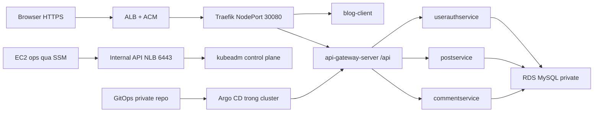

# BlogApp dev — Thực hành thủ công AWS Console từ đầu đến HTTPS và GitOps

Ngày biên soạn và kiểm nguồn: **18/10/2026**. Cập nhật CIDR theo VPC bạn đang dùng: **19/10/2026**. Thực hiện trên **AWS Console và terminal EC2**, không dùng Terraform/Ansible trong bài này. Bạn đã chọn có tên miền và triển khai HTTPS với ACM.

## 0. Đọc trước: kết quả và quy tắc thực hành

Đích của bài: một môi trường dev thực sự phục vụ năm module BlogApp qua `https://<hostname-của-bạn>`, database RDS private, Kubernetes kubeadm, migration tách app startup, đăng nhập/tạo bài/bình luận được; sau đó Argo CD quản lý manifests và có bài cập nhật/rollback. Phần monitoring có code đầy đủ riêng ở cuối.

Đây là **dev thủ công để học luồng**. Worker cố định, chưa có ASG/CA/HPA tự tăng máy, external CCM/workload OIDC, CSI/PVC, blue-green analysis, SOPS/CMP và stack Loki/Tempo. Không cần chúng để chạy đường request này; chúng là bước mở rộng đã có trong bộ kiến trúc gốc. Monitoring trong bài dùng storage tạm. Không gọi bài này là production/HA hoặc đã hoàn thành mọi mốc nâng cao D0–D12.

Tài liệu kèm **mã đầy đủ**, không có role/module/chart nội bộ bị bỏ trống. Những giá trị không thể biết trước như domain, endpoint, password, AWS IDs được nhập khi chạy hoặc lấy từ Console. Chỉ cần nhập dữ liệu account của bạn; không phải tự viết phần code còn thiếu. Các file JSON sinh ra là Kubernetes manifests hợp lệ, tương đương YAML.

**Chưa triển khai AWS thay bạn.** Người dùng tự bấm và chạy từng bước. Kết quả đã kiểm ở cuối tài liệu là kiểm cục bộ; chưa có chứng cứ end-to-end trên account của bạn. Không chạy tất cả script trên một máy: mỗi bước ghi rõ **Mac / Console / CP / worker / ops**.

Các block terminal viết theo **Bash**. Mac thường mặc định zsh: mở terminal và gõ `bash` trước khi chạy các block có `read -p`; lệnh đó chỉ mở shell Bash. Trên EC2, `sudo -iu ubuntu` sử dụng shell Bash của user ubuntu. Không paste lệnh shell vào AWS CloudShell khi bước yêu cầu CP/worker/ops: CloudShell không phải một trong các node này.

### Bản đồ luồng



### Mỗi máy làm gì?

| Máy | Vai trò | Loại khởi đầu cho lab | Root disk |
|---|---|---|---|
| `blogapp-cp` | Control plane/etcd, không build image | `t3.medium`, amd64 | 30 GiB gp3 encrypted |
| `blogapp-worker-1` | Chạy app/controllers | `t3.large`, amd64 | 40 GiB gp3 encrypted |
| `blogapp-worker-2` | Chạy app/controllers | `t3.large`, amd64 | 40 GiB gp3 encrypted |
| `blogapp-ops` | Build/test, mysql/Flyway, kubectl/Helm/Git | `t3.xlarge`, amd64 | 80 GiB gp3 encrypted |

Đây là sizing khởi đầu, không benchmark. Ops có thể hạ sau build/test; kiểm chênh CPU credits của T3 khi build lâu. RDS `db.t4g.small` dùng kiến trúc ARM ở phía dịch vụ, không xung đột image ứng dụng amd64 vì kết nối bằng giao thức MySQL.

### Bộ version đã chốt cho bài

| Thành phần | Pin / căn cứ |
|---|---|
| Ubuntu | 24.04 LTS amd64 từ publisher Canonical; ghi lại AMI ID thật |
| Kubernetes | `v1.36.5`, packages `1.36.5-1.1` |
| containerd / runc / CNI plugins | `2.3.5` / `1.4.0` / `1.9.1`, checksum trong script |
| Calico | `v3.33.0`, VXLAN; tài liệu bản này liệt kê K8s 1.35/1.36/1.37 |
| Helm / Traefik chart | Helm `3.22.0`, chart `42.0.0` |
| Argo CD | `v3.5.5`, install manifest có SHA256 |
| Flyway CLI | `13.10.3`, image pin digest trong code; runtime app tắt Flyway |
| Prometheus / Grafana tùy chọn | `3.15.0` / `13.2.4`, image pin digest |
| RDS | MySQL **8.4**, chọn minor patch thực tế Console hỗ trợ và ghi lại |

Không lấy Kubernetes patch khác cho một worker. Script node dùng containerd 2.x để đồng bộ runtime với minor đã chọn. Các URL release/packages đã đối chiếu khi viết; không ngầm nâng major nếu một URL/package sau này không còn tồn tại.

## 1. Chuẩn bị thông tin, budget và file thực hành

**Trên Console:** đăng nhập danh tính quản trị lab theo cơ chế account hiện có, ưu tiên SSO/MFA; chọn region **Singapore `ap-southeast-1`**. Không dùng root account để vận hành hằng ngày. Quyền cần: tạo VPC/subnet/route/IGW/NAT/SG, EC2+PassRole, IAM EC2 role, RDS/subnet/parameter group, S3, ACM và DNS zone bạn quản lý. Nếu thiếu quyền ở account tổ chức, yêu cầu cấp đúng nhóm quyền; không xử lý bằng mở SG toàn mạng.

**Billing → Budgets → Create budget:** đặt monthly cost budget theo số tiền bạn chấp nhận và email cảnh báo. Budget gửi cảnh báo, không bảo đảm tự ngắt phí. Bài tạo 4 EC2, RDS, NAT, ALB, NLB, EBS và S3; không coi là free tier. Dùng [AWS Pricing Calculator](https://calculator.aws/) để tính theo region/giờ bật của bạn.

Tạo một ghi chú riêng có bảng sau. ID thật chỉ lấy sau khi tạo; code không yêu cầu bạn đoán ID:

| Cần ghi | Tên gợi ý |
|---|---|
| Account / region | dev account / ap-southeast-1 |
| Dev hostname | Ví dụ `dev.blog.tenmiencuaban.com`, dùng một hostname duy nhất |
| VPC | `blogapp-manual-dev` |
| 2 AZ available | Ví dụ ap-southeast-1a và ap-southeast-1b; kiểm thật trong account |
| 6 subnet IDs | public-a/b, private-a/b, db-a/b |
| SG IDs | alb, api-nlb, nodes, ops, db |
| 4 EC2 IDs/private IP | cp, worker-1, worker-2, ops |
| API NLB DNS | Internal NLB `...elb.amazonaws.com` |
| RDS endpoint | `...rds.amazonaws.com`, không có `:3306` |
| ALB DNS / ACM ARN | Ghi sau khi tạo |
| AMI ID / RDS patch | Giá trị đã chọn thật |

Các hostname `example.com` trong lời giải thích là ví dụ, không dùng làm domain thật. Không lưu password, PAT hay private key trong bảng ghi chú công khai.

### Lấy code theo một trong hai cách

- Toàn bộ nội dung từng file có ở **phụ lục cuối tài liệu**, với lệnh `cat > file` đầy đủ.
- Hoặc dùng [gói code ZIP](manual-aws/blogapp-manual-code.zip), upload vào S3 ở bước 4 và tải trên các máy. Các script trong ZIP trùng phần phụ lục. Không có Terraform hay script tự tạo tài nguyên AWS.

Các bước bên dưới dùng thư mục `$HOME/blogapp-manual` trên **từng EC2**, mỗi máy có một HOME riêng. Trên tất cả phiên Session Manager, dùng `sudo -iu ubuntu` để tránh lẫn `ssm-user`, root và ubuntu.

Script chỉ gom những lệnh được in đầy đủ trong phụ lục để bạn copy ít sai; chúng không điều phối hoặc tạo AWS resources. Đọc từng nhóm lệnh trong script trước khi chạy để thấy rõ thay đổi OS, runtime, database và Kubernetes tương ứng bước Console nào.

## 2. Console — Tạo VPC, subnet, Internet Gateway và routes

Chọn tạo thủ công từng tài nguyên để nhìn rõ liên kết, không dùng default VPC.

### 2.0 CIDR của VPC bạn đang thực hành và ZIP đã tải trước đó

Bản thủ công này đã điều chỉnh theo VPC thực tế **`10.0.0.0/16`**; IP worker bạn cung cấp là `10.0.10.183`. Hai subnet DB dùng **`10.0.20.0/24` và `10.0.21.0/24`**. Giá trị bạn gõ `0.0.20.0/24` được hiểu là thiếu chữ số `1`: dải đó nằm ngoài VPC này; đối chiếu lại CIDR của DB subnet trong Console trước bước triển khai app.

Các tài liệu thiết kế/IaC trước đó có thể vẫn dùng `10.10.0.0/16`; khi làm bài thủ công, dùng nhất quán các giá trị ở tài liệu này. Giữ Pod CIDR `172.20.0.0/16` và Service CIDR `172.30.0.0/16` nếu chúng không trùng mạng khác của bạn. Không cần tạo lại VPC/node đã có chỉ vì CIDR khác bản ban đầu. Các subnet trong bảng sau là bố trí của bài; với subnet đã tạo, đối chiếu giá trị thực trước khi tiếp tục.

**Nếu đã tải ZIP cũ lên EC2:** sửa đúng hai file sau. Trên **CP**, trước khi chạy `20-control-plane.sh`:

```bash
sed -i 's/10\.10\./10.0./g' "$HOME/blogapp-manual/code/20-control-plane.sh"
bash -n "$HOME/blogapp-manual/code/20-control-plane.sh"
```

Trên **ops**, trước khi chạy `80-app.py`:

```bash
sed -i 's/10\.10\./10.0./g' "$HOME/blogapp-manual/code/80-app.py"
```

Cấu hình Traefik ở mục 14 cũng đã đổi `trustedIPs` thành `10.0.0.0/16`; dùng block mới khi đến bước đó. `10-node.sh` không có CIDR cố định nên CP/workers vẫn chạy bản đã tải. Các lệnh `sed` chỉ cập nhật file, không chạy init hay thay tài nguyên trong cluster. Nếu đã init CP, không chạy lại installer; nếu app/Traefik đã triển khai thì phải cập nhật theo chủ sở hữu manifests tương ứng.

Sau khi sửa tay, hai file đã sửa sẽ khác `SHA256SUMS` của ZIP cũ; điều đó không xác minh được bằng checksum cũ. ZIP mới có checksum riêng ở mục 25, cần upload lại lên S3 nếu muốn tải bản mới từ đó. File trên máy này không tự cập nhật file trên EC2 hoặc object S3.

### 2.1 VPC

1. **VPC → Your VPCs → Create VPC → VPC only**.
2. Name: `blogapp-manual-dev`; IPv4 CIDR: `10.0.0.0/16`; không IPv6 trong bài; tenancy Default.
3. Create VPC.
4. Chọn VPC → Actions → Edit VPC settings → bật **DNS resolution** và **DNS hostnames**.
5. Giữ DHCP options mặc định dùng AmazonProvidedDNS; không thay DNS node thành 8.8.8.8.

`/16` là vùng địa chỉ toàn VPC. Pod CIDR `172.20.0.0/16` và Service CIDR `172.30.0.0/16` sẽ dùng sau, không trùng VPC/LAN/VPN của bạn.

### 2.2 Sáu subnet

**VPC → Subnets → Create subnet**, chọn VPC trên. Tạo đúng bảng:

| Name | AZ | IPv4 CIDR | Dùng cho |
|---|---|---|---|
| `blogapp-public-a` | AZ a bạn đã chọn | `10.0.0.0/24` | NAT, ALB |
| `blogapp-public-b` | AZ b | `10.0.1.0/24` | ALB |
| `blogapp-private-a` | AZ a | `10.0.10.0/24` | CP, worker-1, ops |
| `blogapp-private-b` | AZ b | `10.0.11.0/24` | worker-2 |
| `blogapp-db-a` | AZ a | `10.0.20.0/24` | DB subnet group |
| `blogapp-db-b` | AZ b | `10.0.21.0/24` | DB subnet group |

Auto-assign public IPv4 để **Disabled**, kể cả subnet public: ALB/NAT quản public address riêng; bốn EC2 đều private.

### 2.3 IGW

**Internet gateways → Create internet gateway**, name `blogapp-igw`. Sau tạo: Actions → Attach to VPC → VPC BlogApp. IGW chưa tự làm subnet public; cần route ở bước kế tiếp.

### 2.4 Public route table

**Route tables → Create route table**, name `blogapp-public-rt`, VPC BlogApp.

1. Routes → Edit routes → thêm `0.0.0.0/0` → Internet Gateway → `blogapp-igw`.
2. Subnet associations → Edit → chọn **chỉ public-a và public-b**.

`10.0.0.0/16 → local` là route nội bộ AWS có sẵn, giữ nguyên.

### 2.5 NAT

**NAT gateways → Create NAT gateway**: chọn kiểu public/zonal NAT Gateway, name `blogapp-nat-a`, subnet **public-a**, connectivity Public, Allocate Elastic IP mới. Nếu Console có lựa chọn Regional NAT, chọn cấu hình zonal để khớp bài này. Chờ state **Available**.

NAT cho private EC2 tải packages/GitHub/GHCR/SSM ra Internet; nó không cho Internet tự mở kết nối vào node. Một NAT là lựa chọn tiết kiệm cho dev, có phụ thuộc AZ a; chưa phải topology prod.

### 2.6 Private và DB route table

- Tạo `blogapp-private-rt`: thêm `0.0.0.0/0 → NAT Gateway blogapp-nat-a`, associate **private-a/private-b**.
- Tạo `blogapp-db-rt`: **chỉ giữ local**, associate **db-a/db-b**, không thêm route IGW/NAT.

**Checkpoint:** nhìn tab associations của cả ba route tables. Public→IGW; private→NAT; DB chỉ local. Chưa tạo EC2 nếu route chưa đúng: SSM sẽ offline và apt/curl sẽ timeout.

## 3. Console — IAM role và Security Groups

### 3.1 IAM cho EC2 qua SSM

**IAM → Roles → Create role → AWS service → EC2**.

1. Attach AWS managed policy **AmazonSSMManagedInstanceCore**.
2. Role name `blogapp-manual-ec2-ssm`.
3. Create role. Console tạo instance profile tương ứng cho EC2.

Chỉ role SSM là đủ cho node/ops trong bài. Source và code tải bằng URL presigned; master DB password được người vận hành lấy ở Console. Không attach AdministratorAccess/S3FullAccess/EBSFullAccess cho node. Không cần dựng IAM OIDC của workload khi chưa có pod gọi AWS API.

### 3.2 Tạo năm SG trước, thêm reference rules sau

**EC2 → Security Groups → Create security group**, tạo các tên dưới trong đúng VPC. Tạm giữ outbound **All traffic → 0.0.0.0/0** cho lab; inbound khai báo chính xác. SG stateful, response traffic được theo dõi; NACL để mặc định cho bài, chưa thêm một lớp rule có thể chặn nhầm.

| SG | Inbound cần thêm |
|---|---|
| `blogapp-alb-sg` | TCP 80 từ 0.0.0.0/0; TCP 443 từ 0.0.0.0/0 |
| `blogapp-api-nlb-sg` | TCP 6443 từ **ops-sg**; TCP 6443 từ **nodes-sg** |
| `blogapp-nodes-sg` | **All traffic từ chính nodes-sg**; TCP 6443 từ api-nlb-sg; TCP 6443 từ ops-sg; TCP 30080 từ alb-sg; TCP 30080 từ ops-sg |
| `blogapp-ops-sg` | Không inbound rule; quản bằng Session Manager |
| `blogapp-db-sg` | TCP 3306 từ nodes-sg; TCP 3306 từ ops-sg |

Chọn source type **Custom** rồi tìm **SG ID**, không gõ CIDR hoặc tên pod. Self-reference của nodes-sg cho phép các node cluster trao đổi kubelet, etcd, VXLAN và DNS/overlay trong bài. Đây là rule rộng **bên trong nhóm node lab**, không phải port matrix tối thiểu cho prod; sau khi hiểu luồng mới tách CP/worker SG. Port 30080 từ ops dùng để kiểm tra ingress trước ALB. Không có rule public 22, 6443, 9090, 30080 hay 3306.

## 4. Console — S3 private để chuyển code và snapshot source

**S3 → Create bucket**: tên duy nhất như `blogapp-manual-lab-<account-id>-ap-southeast-1`, region Singapore, Object Ownership bucket owner enforced, **Block all public access ON**, default encryption ON. Không public website/ACL. Bucket này dành source/code tạm, không phải Terraform state hoặc backup secret.

Upload gói `blogapp-manual-code.zip` vào prefix `manual/`. Chọn object → menu Share/Actions → **Share with a presigned URL**, chọn thời hạn đủ cho phiên tải (ví dụ một giờ). URL này cho phép tải object trong thời hạn, giữ như một token truy cập; không dán vào Git/issue. Khi hết hạn, tạo URL mới từ Console, không mở public bucket.

### Snapshot source đúng commit từ Mac

**Trên terminal Mac**:

```bash
cd /Users/hoangvinh/Library/CloudStorage/OneDrive-Personal/Workspace/blog_app_microservices
git status --short --branch
git rev-parse HEAD
git archive --format=tar.gz --output=/tmp/blogapp-source.tar.gz HEAD
shasum -a 256 /tmp/blogapp-source.tar.gz
```

Ghi full 40-char commit SHA và 64-char archive checksum. Archive gồm file tracked ở HEAD, không gồm `.git`, `.env` untracked, caches hoặc các bản `.js` untracked đang có trên máy. Cách này dùng được cả commit local chưa push, không yêu cầu lấy nhầm main trên GitHub.

Upload `/tmp/blogapp-source.tar.gz` vào bucket private, tạo presigned URL cho object source riêng. Script 50 sẽ hỏi URL/SHA; không cần hardcode credential AWS trên ops.

## 5. Console — Tạo bốn EC2 private

Vào **EC2 → Instances → Launch instances**, làm **từng máy** để không nhầm subnet/SG/instance name:

1. Name và size theo bảng mục 0.
2. AMI: **Ubuntu Server 24.04 LTS, x86_64, publisher Canonical**. Không ARM, không chọn community AMI chỉ vì tên giống Ubuntu. Ghi AMI ID.
3. Key pair: **Proceed without a key pair**; dùng SSM, không mở SSH.
4. Network settings → Edit → VPC BlogApp → subnet theo bảng dưới → Auto-assign public IP **Disable**.
5. Existing SG: nodes-sg cho CP/workers; ops-sg cho ops. Không để launch wizard tạo thêm SG mặc định.
6. Storage gp3 encrypted theo bảng; CP không Spot, không tự xóa/thay máy khi gặp lỗi.
7. Advanced details → IAM instance profile `blogapp-manual-ec2-ssm`.
8. Metadata: endpoint Enabled, **IMDSv2 Required**, hop limit **1**.
9. User data: copy nguyên block bên dưới; không đặt password/JWT/token trong user_data.
10. Launch, chờ status checks passed và SSM Online.

| Máy | Subnet |
|---|---|
| CP | private-a |
| worker-1 | private-a |
| worker-2 | private-b |
| ops | private-a |

**User data chung cho cả bốn máy**:

```bash
#!/bin/bash
set -euo pipefail
if snap list amazon-ssm-agent >/dev/null 2>&1; then
  snap start --enable amazon-ssm-agent
else
  apt-get update
  apt-get install -y ca-certificates curl
  curl -fL --retry 3 \
    https://s3.ap-southeast-1.amazonaws.com/amazon-ssm-ap-southeast-1/latest/debian_amd64/amazon-ssm-agent.deb \
    -o /tmp/amazon-ssm-agent.deb
  dpkg -i /tmp/amazon-ssm-agent.deb
  systemctl enable --now amazon-ssm-agent
fi
```

SSM agent latest ở bước bootstrap chỉ là agent quản trị của vendor; phiên bản Kubernetes/runtime phía sau được pin riêng. Nếu user_data thất bại, xem EC2 system log hoặc cloud-init log bằng kênh phục hồi phù hợp; kiểm route/NAT/profile trước đổi networking.

### Kết nối và tải code trên từng máy

Chọn instance → **Connect → Session Manager → Connect**. Nếu tab chưa available, chờ agent hoặc kiểm IAM/route; Running chưa đủ.

Trong mỗi session:

```bash
sudo -iu ubuntu
mkdir -p "$HOME/blogapp-manual/code"
sudo apt-get update
sudo apt-get install -y curl unzip
read -rs -p 'Presigned URL của manual-code.zip: ' LAB_CODE_URL
printf '\n'
curl --fail --location --retry 3 "$LAB_CODE_URL" -o "$HOME/blogapp-manual/manual-code.zip"
unset LAB_CODE_URL
```

**So checksum ZIP với giá trị ở phần “Kiểm chứng và đóng gói” cuối bản này** trước unzip/chạy; lệnh đầy đủ có tại đó. Sau so thành công:

```bash
unzip "$HOME/blogapp-manual/manual-code.zip" -d "$HOME/blogapp-manual/code"
cd "$HOME/blogapp-manual/code"
ls
```

Nếu dùng phụ lục thay ZIP, tạo file đúng tên trong `~/blogapp-manual/code` bằng block cat tương ứng; không cần tải ZIP. Không chạy `chmod +x` nếu luôn gọi `bash file.sh`/`python3 file.py` như hướng dẫn.

## 6. Console — RDS subnet group, parameter group và MySQL

Làm ngay sau EC2; RDS có thể tạo trong lúc bạn dựng cluster.

### 6.1 Subnet group

**RDS → Subnet groups → Create DB subnet group**: name `blogapp-manual-db-subnets`, VPC BlogApp, chọn cả hai AZ và **chỉ db-a/db-b**. Hai AZ là điều kiện nhóm subnet, không có nghĩa bạn đã bật DB Multi-AZ.

### 6.2 Parameter group

**RDS → Parameter groups → Create parameter group**: engine MySQL, family **mysql8.4**, type DB parameter group, name `blogapp-manual-mysql84`. Edit parameters → `require_secure_transport` = **ON** → save. Nếu Console yêu cầu apply method, dùng immediate cho dynamic parameter này. Không chọn MariaDB/Aurora family.

### 6.3 DB instance

**RDS → Databases → Create database → Standard create**:

| Trường | Giá trị |
|---|---|
| Engine | MySQL Community, version 8.4 minor patch có sẵn |
| Template / deployment | Dev/Test; **Single DB instance**, Single-AZ |
| Identifier | `blogapp-manual-dev` |
| Master username | `blogapp_bootstrap` |
| Credentials | **Manage master credentials in AWS Secrets Manager** |
| Instance class | `db.t4g.small` hoặc class tương đương thực sự hỗ trợ 8.4 tại region |
| Storage | gp3, 20 GiB; trần autoscale 100 GiB nếu bật |
| Connect EC2 resource | **Don't connect to an EC2 compute resource**; SG đã quản riêng |
| VPC / subnet group | BlogApp / `blogapp-manual-db-subnets` |
| Public access | **No** |
| Security group | Chỉ `blogapp-db-sg`, bỏ default SG |
| Port | 3306 |
| DB parameter group | `blogapp-manual-mysql84` |
| Initial DB name | Để trống; script sẽ tạo đủ ba DB |
| Backup | Retention 7 ngày, chọn cửa sổ phù hợp |
| Encryption | Enabled, ghi key đang chọn |
| Deletion protection | Enabled |
| Monitoring | Chọn tính năng phù hợp budget; không bật tùy chọn trả phí mà chưa đọc giá |

Create database, chờ **Available**. Kiểm tab Connectivity & security, Configuration: private, SG đúng, parameter group in-sync, encryption/backup đúng. Copy endpoint không kèm port. Console có thể đặt tên menu khác theo bản cập nhật; đối chiếu **giá trị cấu hình**, không chọn cấu hình khác chỉ để khớp ảnh/menu.

Master credentials ARN → Secrets Manager → Retrieve secret value: chỉ lấy password khi script hỏi. Không cấp master credential cho Kubernetes app. Theo [AWS managed master credentials](https://aws.amazon.com/blogs/security/improve-security-of-amazon-rds-master-database-credentials-using-secrets-manager/) và [MySQL TLS requirement](https://docs.aws.amazon.com/AmazonRDS/latest/UserGuide/mysql-ssl-connections.require-ssl.html).

## 7. Console — Internal NLB cho Kubernetes API

### 7.1 Target group control plane

**EC2 → Target groups → Create target group**:

- Target type **Instances**, name `blogapp-api-tg`.
- Protocol **TCP**, port **6443**, IPv4, VPC BlogApp.
- Health check TCP/traffic port.
- Register **chỉ instance blogapp-cp**, port 6443 → Include as pending → Create.

Sau tạo TG: **Attributes → Edit → Preserve client IP addresses OFF**, giữ **Proxy protocol v2 OFF**. CP sẽ gọi chính endpoint NLB trỏ về nó; giữ client IP có thể làm kết nối hairpin này thất bại. Tắt preservation cho TG TCP API để NLB SNAT đường quay về; không bật PROXY protocol vì kube-apiserver không xử lý header đó. Đây là thuộc tính TG API, không sửa TG HTTP của ALB. Theo [AWS: target không kết nối được NLB của chính nó](https://repost.aws/knowledge-center/target-connection-fails-load-balancer).

### 7.2 NLB

**EC2 → Load balancers → Create → Network Load Balancer**:

- Name `blogapp-api`, scheme **Internal**, IPv4.
- VPC BlogApp; mappings **private-a/private-b**, không public subnet.
- Security group **blogapp-api-nlb-sg ngay lúc tạo**.
- Listener TCP 6443 → target group `blogapp-api-tg`.
- Create. Sau đó Attributes → Edit → **Cross-zone load balancing ON**.

Vì chỉ có một CP ở AZ a, bật cross-zone để NLB node ở AZ b cũng chuyển request tới CP. Nếu bỏ bước này, join/API có thể lỗi tùy IP DNS trả về. Xem [NLB cross-zone attributes](https://docs.aws.amazon.com/elasticloadbalancing/latest/network/edit-load-balancer-attributes.html).

Copy NLB DNS. Target **unhealthy lúc này là bình thường** vì kube-apiserver chưa chạy. Đừng chờ target healthy rồi mới kubeadm init: đó là vòng phụ thuộc không thể hoàn thành.

## 8. CP + hai workers — Cài OS/runtime/Kubernetes

Mở ba tab Session Manager và phân biệt rõ bằng `hostname`/EC2 name.

**Trên CP và cả hai worker**, chạy:

```bash
sudo bash "$HOME/blogapp-manual/code/10-node.sh"
```

Khi hỏi node name, nhập đúng `blogapp-cp`, `blogapp-worker-1`, `blogapp-worker-2` cho từng máy. Không chạy trên ops.

Script tắt swap, persist kernel modules/sysctl, cài containerd/runc/CNI qua checksum, tạo systemd service, cấu hình systemd cgroup, cài/hold kubeadm/kubelet/kubectl đúng patch. Runtime không cần Docker Engine; Docker chỉ cài trên ops để build/test/Flyway. Kubelet restart trước init/join chưa phải lỗi cần reset.

**Checkpoint trên từng node**:

```bash
hostname
sudo systemctl is-active containerd
sudo crictl info >/dev/null
kubeadm version -o short
swapon --show
```

Version phải `v1.36.5`, swap output trống, CRI command exit 0. Nếu checksum sai, dừng trước khi cài. Script không dùng lại để nâng node đang chạy; nó chủ động từ chối khi đã có kubelet.conf.

## 9. CP — kubeadm init và Calico

**Chỉ trên CP**:

```bash
sudo bash "$HOME/blogapp-manual/code/20-control-plane.sh"
```

Nhập internal NLB DNS đã ghi, không thêm `https://`/`:6443`. Script tự tìm private IP, tạo kubeadm v1beta4 config, encrypt Secrets at rest, init cluster và cài Calico VXLAN. API cert có SAN cho đúng NLB DNS; không cần tắt TLS verification.

Sau hoàn thành:

```bash
sudo -i
export KUBECONFIG=/etc/kubernetes/admin.conf
kubectl get --raw='/readyz?verbose'
kubectl get nodes -o wide
kubectl get pods -A
```

Giữ shell root này cho các bước CP. NLB target phải chuyển healthy sau API chạy. CoreDNS/Calico controllers có thể còn Pending trước worker join; chưa kết luận cluster lỗi chỉ vì còn một CP đang tainted.

`/etc/kubernetes/encryption-config.yaml`, PKI và etcd state là dữ liệu phục hồi quan trọng. Không sinh key mới mỗi lần chạy; script sẽ từ chối init lại. Chạy sai trên CP có state không được giải quyết bằng `kubeadm reset` tùy tiện.

## 10. CP → workers — Join hai worker thủ công

**Trên CP, shell root ở trên**:

```bash
kubeadm token create --ttl 30m --print-join-command
```

Lệnh trả một dòng **join thật** có token và CA hash. Copy nguyên dòng, thêm `sudo` ở đầu nếu worker đang dùng ubuntu, chạy trên **worker-1** và **worker-2**. Không chép token vào Git/S3/user_data. Nếu quá 30 phút, tạo token mới. Không dùng unsafe-skip-ca-verification.

Không có dòng join giả với token bỏ trống trong hướng dẫn này: dòng hợp lệ chỉ sinh sau cluster của bạn tồn tại.

**Trên CP**:

```bash
kubectl wait --for=condition=Ready node/blogapp-worker-1 --timeout=600s
kubectl wait --for=condition=Ready node/blogapp-worker-2 --timeout=600s
kubectl label node blogapp-worker-1 blogapp.io/pool=app --overwrite
kubectl label node blogapp-worker-2 blogapp.io/pool=app --overwrite
kubectl get nodes -o wide
kubectl -n kube-system rollout status deployment/coredns --timeout=300s
kubectl -n calico-system rollout status daemonset/calico-node --timeout=600s
```

Phải có đúng ba node cluster, ops không xuất hiện. Giữ CP taint, app dùng nodeSelector `blogapp.io/pool=app`. Bản thủ công không bật `--cloud-provider=external`, nên không chờ CCM xóa cloud-provider taint; chưa dùng CSI/ASG/cloud features phụ thuộc providerID.

## 11. Ops — Cài tools và cấp kubeconfig bằng CSR public

### 11.1 Tools

**Trên ops**:

```bash
sudo bash "$HOME/blogapp-manual/code/30-ops-tools.sh"
exit
```

Mở lại session, `sudo -iu ubuntu`, kiểm `docker info` không cần sudo. Group docker có quyền tương đương root, chỉ dùng trên ops lab được quản trị, không cấp cho user không tin cậy. Ops có Docker/Java keytool/mysql-client/kubectl/Helm; không kubelet join.

### 11.2 Tạo private key trên ops, chỉ chuyển CSR public

```bash
bash "$HOME/blogapp-manual/code/31-operator-request.sh"
```

Copy dòng CSR base64 công khai mà script in ra. Private key vẫn ở ops `private/operator.key`, không đi qua CP terminal. Đây là cách cấp operator certificate, không cần in/chuyển toàn bộ admin.conf.

**Trên CP, root với KUBECONFIG đã export**:

```bash
read -r -p 'Dán một dòng PUBLIC CSR từ ops: ' OPERATOR_CSR
kubectl apply -f - <<EOF
apiVersion: certificates.k8s.io/v1
kind: CertificateSigningRequest
metadata:
  name: blogapp-manual-operator
spec:
  request: ${OPERATOR_CSR}
  signerName: kubernetes.io/kube-apiserver-client
  expirationSeconds: 604800
  usages:
    - client auth
EOF
unset OPERATOR_CSR
kubectl certificate approve blogapp-manual-operator
kubectl wait --for=jsonpath='{.status.certificate}' csr/blogapp-manual-operator --timeout=60s
kubectl create clusterrolebinding blogapp-manual-operators \
  --clusterrole=cluster-admin --group=blogapp-manual-operators \
  --dry-run=client -o yaml | kubectl apply -f -
printf 'PUBLIC CA:\n'
base64 -w0 /etc/kubernetes/pki/ca.crt
printf '\nPUBLIC SIGNED CLIENT CERT:\n'
kubectl get csr blogapp-manual-operator -o jsonpath='{.status.certificate}'
printf '\n'
```

Certificate có thời hạn yêu cầu 7 ngày. Group cluster-admin chỉ cho operator bootstrap lab; app ServiceAccounts không có quyền đó. Hai dòng certificate/CA là public; private key không được in. Đọc CN/group trong CSR trước approve nếu làm ngoài bài lab cá nhân.

**Trên ops**:

```bash
python3 "$HOME/blogapp-manual/code/32-operator-complete.py"
export KUBECONFIG="$HOME/blogapp-manual/private/kubeconfig"
kubectl get nodes -o wide
kubectl auth can-i create deployments -n blogapp-dev
```

Nhập NLB DNS, public CA base64 và signed client cert base64 từ CP. Script kiểm CA rồi tạo kubeconfig nhúng credential, mode hạn chế. **Mỗi shell mới trên ops phải export KUBECONFIG lại.** Không bật insecure-skip-tls-verify và không in file kubeconfig.

Nếu hết hạn: chạy lại script 31 trên ops để tạo CSR mới bằng key cũ, trên CP xóa **CSR object** `kubectl delete csr blogapp-manual-operator`, rồi lặp bước ký/32. Việc xóa CSR object không phải xóa cluster hay thu hồi ngay cert cũ; quản vòng đời credential riêng khi chuyển sang môi trường nhiều người.

## 12. Ops — Chuẩn bị đúng source, test và publish năm image

### 12.1 Source snapshot và overlay lab

```bash
python3 "$HOME/blogapp-manual/code/50-prepare-source.py"
```

Nhập commit SHA, archive SHA256, presigned URL **của source tar.gz** ở bước 4. Script kiểm hash trước extract, không clone nhầm remote main. Source nằm ở `~/blogapp-manual/source`; repo gốc trên Mac không thay đổi.

Overlay nhỏ có ba mục đích:

1. Business service nhận CORS origin từ `BLOG_ALLOWED_ORIGIN`, default vẫn localhost để tests cũ chạy được.
2. Cho phép `/actuator/prometheus` của management server nội bộ; không thêm public ingress cho 9090.
3. Gateway thêm Prometheus registry/exposure, để mục monitoring scrape được cả bốn Java service.

Script assert đúng đoạn code nguồn đã audit, không thay mù quáng nếu source khác. Receipt ghi source/archive/overlay SHA và file đã đổi. Đây là **manual lab image**, chưa phải image do CI main ký; namespace image riêng tránh lẫn release production.

### 12.2 Chuẩn bị GHCR tokens

Trên GitHub web: Settings → Developer settings → Personal access tokens → **Tokens classic**. Tạo token publish có write:packages (read cần thiết) và thời hạn ngắn; không thêm delete:packages. GitHub có thể tự tick repo khi chọn write:packages; kiểm bỏ scope không cần thiết hoặc theo [hướng dẫn GHCR](https://docs.github.com/en/packages/working-with-a-github-packages-registry/working-with-the-container-registry). Với organization SSO, token phải được authorize phù hợp.

Tạo **token thứ hai chỉ read:packages** cho cluster pull; không cấp token publish vào pod. Không dán token vào shell command/history hoặc tài liệu.

### 12.3 Verify/build/push

```bash
python3 "$HOME/blogapp-manual/code/60-build-images.py"
```

Nhập GitHub username lowercase và publish PAT khi script hỏi. Script thực hiện Python policy tests, bốn Maven `clean verify` có Docker/Testcontainers, frontend npm test/build, build/push năm image amd64 và ghi **registry digest** vào `manual-release.json`. Nó logout write credential sau publish.

Build/test có thể lâu; không đóng session giữa chừng. Có thể dùng `tmux`/`screen` nếu đã cài theo nhu cầu, nhưng không biến script thành chạy nền không còn biết kết quả. Chỉ tiếp tục khi exit 0 và đủ năm digest. Không thêm `-DskipTests`/`--passWithNoTests` để vượt lỗi.

Kiểm receipt không chứa credential:

```bash
python3 -m json.tool "$HOME/blogapp-manual/manual-release.json"
```

Không dùng `cat private/settings.json`: file đó sau bước DB sẽ có secret.

## 13. Ops — Tạo ba database, DML users, migration users và migrate

RDS phải Available và đúng parameter group. Lấy master password từ Console Secrets Manager ngay trước chạy:

```bash
python3 "$HOME/blogapp-manual/code/70-database.py"
```

Script hỏi RDS endpoint, dev hostname thật, master username/password. Nó thực hiện đầy đủ:

- Tải AWS RDS CA bundle và tạo **PKCS12 public CA truststore**, không chứa private key.
- Kết nối mysql bằng `VERIFY_IDENTITY`, xác thực CA lẫn hostname.
- Tạo `userdb`, `postdb`, `commentdb`.
- Tạo ba runtime users chỉ SELECT/INSERT/UPDATE/DELETE và ba migrator users DDL theo đúng DB.
- Password ngẫu nhiên hex, user REQUIRE SSL; JWT key random dùng chung auth/post/comment.
- Chạy **Flyway CLI image pin digest** trên ops, bind SQL của đúng source snapshot read-only, từng database; app runtime sau đó `FLYWAY_ENABLED=false` và Hibernate validate.
- Master credential chỉ ở file tạm mode hạn chế rồi xóa; credential app/migration lưu `private/settings.json` mode 0600 để dùng lại lab.

DB MySQL tách logic theo service nhưng chung instance/failure domain. Flyway 13 CLI ở bài điều khiển schema trước deploy; runtime Flyway dependency trong app không chạy, nên không có hai bộ tự migrate tranh nhau.

**Checkpoint:** Flyway báo thành công cho cả ba DB, userdb có V1 và V2. Lỗi TLS phải sửa CA/DNS/parameter, không đổi `sslMode=DISABLED`. Lỗi quyền phải sửa đúng user/DB, không chuyển app sang master. Script sẽ dừng nếu DB đã có users nhưng file credentials local bị mất; cần phục hồi, không tự xoay password ngoài ý muốn.

## 14. Ops — Traefik NodePort và ping đúng đường ALB

**Trên ops, KUBECONFIG đã export**:

```bash
mkdir -p "$HOME/blogapp-manual/platform"
cat > "$HOME/blogapp-manual/platform/traefik-values.yaml" <<'YAML'
deployment:
  replicas: 2
  healthchecksPort: 8000
service:
  spec:
    type: NodePort
    externalTrafficPolicy: Cluster
ports:
  web:
    port: 8000
    exposedPort: 80
    nodePort: 30080
    forwardedHeaders:
      trustedIPs:
        - 10.0.0.0/16
  websecure:
    expose:
      default: false
providers:
  kubernetesIngress:
    enabled: true
  kubernetesCRD:
    enabled: false
ingressClass:
  enabled: true
  isDefaultClass: false
additionalArguments:
  - --ping.entrypoint=web
log:
  format: json
YAML
helm repo add traefik https://traefik.github.io/charts
helm repo update traefik
helm upgrade --install traefik traefik/traefik \
  --version 42.0.0 --namespace traefik --create-namespace \
  --skip-crds \
  -f "$HOME/blogapp-manual/platform/traefik-values.yaml" \
  --wait --timeout 10m
kubectl -n traefik get pods,service
read -r -p 'Private IP worker-1: ' WORKER_ONE_IP
curl --fail "http://${WORKER_ONE_IP}:30080/ping"
```

Phải trả `OK`. Port web **trong pod** 8000, Service 80, NodePort 30080; ALB dùng NodePort chứ không phải pod port. Ping ở web entrypoint nên ALB health check Host=IP vẫn hoạt động. `externalTrafficPolicy=Cluster` cho một node nhận rồi chuyển tới Traefik pod ở node khác. Dashboard Traefik không public.

## 15. Ops — Deploy đủ năm ứng dụng bằng manifests đầy đủ

```bash
python3 "$HOME/blogapp-manual/code/80-app.py"
```

Nhập read-only packages PAT khi hỏi. Script tạo namespace/Secrets qua stdin API, render ConfigMaps/ServiceAccounts/Services/Deployments/Ingress/NetworkPolicy rồi chờ cả năm rollout Ready. Không ghi Kubernetes Secrets vào file manifest hoặc Git.

Các quyết định có trong code:

| Cấu hình | Lý do |
|---|---|
| Gateway URL theo tên Service | Không fallback localhost bên trong pod |
| `/api` giữ nguyên prefix | Controllers nguồn đã chứa `/api` |
| JDBC VERIFY_IDENTITY + mounted CA truststore | Không dùng URL Compose `useSSL=false` cho RDS |
| FLYWAY_ENABLED=false / DML-only user | Migration đã hoàn tất trên ops |
| CORS dev host / forwarded headers framework | Browser hoạt động đúng sau ALB TLS termination |
| Java UID 10001 | Dockerfile hiện USER app dạng tên; UID số giúp kubelet xác minh non-root |
| Read-only root + emptyDir tmp/cache | Java/Nginx vẫn có nơi ghi tạm hợp lệ |
| Probes management 9090 | Không đưa Actuator ra ALB |
| NetworkPolicy | App chỉ nhận ingress từ Traefik/app nội bộ; metrics từ monitoring; egress app/DNS/DB |
| Registry digest | Pod chạy đúng artifact đã publish, không tag latest |

NetworkPolicy của bài là boundary dev, vẫn cho các app trong cùng namespace liên lạc 8080 và RDS subnets; quyền DB bổ sung ranh giới mỗi service. Sau học mới tách từng rule tối thiểu, không trình bày đây là policy prod hoàn chỉnh.

**Kiểm trước ALB, từ ops**:

```bash
kubectl -n blogapp-dev get pods,svc,ingress
read -r -p 'Dev hostname đã nhập ở bước DB: ' DEV_HOST
read -r -p 'Private IP worker-1: ' WORKER_ONE_IP
curl --fail -H "Host: ${DEV_HOST}" "http://${WORKER_ONE_IP}:30080/" >/dev/null
```

Nếu chưa Ready: `kubectl -n blogapp-dev describe pod <tên-pod-thật>` và `kubectl logs <tên-pod-thật> --previous` cho crash. Tên pod lấy từ lệnh get, không phải điền một tên giả. Đọc lỗi trước đổi resources/password/schema.

## 16. Console — ACM, ALB HTTPS và DNS thật

### 16.1 ACM certificate

**ACM tại Singapore → Request certificate → Public certificate**.

1. Domain: **đúng dev hostname** dùng trong script 70.
2. Validation DNS, key type theo lựa chọn hiện hành phù hợp ALB (RSA 2048 là baseline).
3. Request. Mở certificate → Domains → copy DNS validation CNAME.
4. Nếu Route 53 zone đúng account: Create records in Route 53. Nếu DNS nơi khác: tạo CNAME chính xác tại provider; tránh provider tự thêm suffix lần hai.
5. Chờ status **Issued**. Giữ validation CNAME để renewal.

Certificate gắn ALB phải ở cùng region; certificate domain phải khớp hostname client yêu cầu. Đây là ACM public certificate, không phải Private CA. Xem [ALB certificates](https://docs.aws.amazon.com/elasticloadbalancing/latest/application/https-listener-certificates.html).

### 16.2 Target group cho Traefik

**EC2 → Target groups → Create**:

- Target type Instances; name `blogapp-web-tg`.
- Protocol HTTP; port **30080**; VPC BlogApp.
- Health check protocol HTTP, port traffic port, path **/ping**, matcher **200**.
- Register **worker-1 và worker-2**, port 30080, Include as pending → Create.

Không register CP/ops. Hai targets phải healthy khi Traefik đã lên và SG đúng. Health ping không chứng minh login/DB hoạt động; smoke là bước riêng.

### 16.3 Public ALB

**Create load balancer → Application Load Balancer**:

- Name `blogapp-web`, **Internet-facing**, IPv4.
- VPC BlogApp; mappings **public-a/public-b**, không private hoặc DB subnets.
- SG **blogapp-alb-sg**, bỏ default.
- Listener **HTTPS 443 → blogapp-web-tg**; chọn ACM certificate vừa Issued; chọn TLS policy hỗ trợ TLS 1.2/1.3 theo Console khuyến nghị và ghi tên.
- Listener **HTTP 80 → Redirect HTTPS port 443, status HTTP_301**, không forward HTTP vào app.
- Create; chờ Active, targets healthy. Copy ALB DNS, không copy một IP cố định.

ALB kết thúc TLS rồi gửi HTTP tới private workers; RDS vẫn TLS end-to-end ở lớp JDBC. NLB 6443 chỉ dành API Kubernetes, không thay ALB.

### 16.4 DNS application

- Route 53: hosted zone public đúng domain đã delegate → Create record → tên dev hostname → **A Alias to Application Load Balancer**, region Singapore, chọn ALB.
- DNS provider khác: tạo **CNAME** của dev subdomain đến ALB DNS. Nếu Cloudflare, ban đầu chọn **DNS only** để nghiệm thu đường ALB trực tiếp; cấu hình proxy/CDN là bài riêng.

Không dùng A record trỏ IP ALB. Chờ DNS resolve. Test từ **Mac/bên ngoài VPC**:

```bash
read -r -p 'Dev hostname: ' DEV_HOST
nslookup "$DEV_HOST"
curl --fail --silent --show-error --head "https://${DEV_HOST}/"
curl --silent --show-error --head "http://${DEV_HOST}/"
```

HTTPS phải xác thực certificate bình thường, không `curl -k`; HTTP phải redirect HTTPS. Browser mở hostname, không cảnh báo cert. Nếu record/certificate chưa đúng, sửa DNS/ACM/listener trước, không bỏ qua security warning.

## 17. Ops + browser — Nghiệm thu dev chạy được

**Trên ops**:

```bash
cd "$HOME/blogapp-manual/source"
read -r -p 'Dev hostname: ' DEV_HOST
BLOG_URL="https://${DEV_HOST}" sh scripts/smoke-test.sh
```

Script nguồn đã có kiểm signup/login/post/comment, malformed JWT=401, cross-user delete=403 và xóa post/comment test. Nó **không xóa hai user test đã signup**, nên đây là dữ liệu dev và cần kế hoạch dọn user riêng.

Browser: signup, login, tạo bài, bình luận và refresh trang SPA. DevTools Network phải gọi cùng origin `/api`, không localhost. Kiểm thêm origin header rõ ràng:

```bash
curl --silent --show-error \
  -H "Origin: https://${DEV_HOST}" \
  "https://${DEV_HOST}/api/post/getAllPosts" \
  --output /dev/null --write-out '%{http_code}\n'
```

Endpoint này cần JWT nên **401 là đúng** khi chưa có token; block này không dùng `--fail`. Dùng kết quả browser/smoke có JWT để xác minh hành vi 200. CORS rejection thường có 403/Invalid CORS request; kiểm env BLOG_ALLOWED_ORIGIN/forwarded headers nếu browser khác smoke. Phần curl này chỉ giúp quan sát response không có token.

**Ghi evidence**: account/region/AMI/RDS patch, source/overlay SHA, năm digest, hostname/certificate, node/pod status và smoke output đã redact. Đến đây đạt mốc **dev chạy thủ công qua HTTPS**.

## 18. Ops + GitHub Console — Đưa cấu hình đã chạy vào Argo CD

Chỉ làm sau smoke pass để tách lỗi ứng dụng khỏi lỗi GitOps.

### 18.1 Tạo repo và public deploy keys

GitHub → New repository → `blogapp-gitops-manual`, Private, **để trống** (không README/.gitignore khởi tạo trên web). Lấy SSH URL `git@github.com:owner/blogapp-gitops-manual.git`.

**Trên ops**:

```bash
python3 "$HOME/blogapp-manual/code/90-gitops.py" init
```

Nhập SSH URL. Script tạo hai key khác nhau, lấy GitHub SSH host public keys qua HTTPS official API (không dùng StrictHostKeyChecking=no), tạo repo local. Nó in **hai public keys**:

1. Repo Settings → Deploy keys → Add → `lab-operator-write`: public key thứ nhất, tick **Allow write access**. Private write key chỉ ở ops.
2. Add → `argocd-dev-read`: public key thứ hai, **không tick write**. Private read key sẽ được bootstrap vào Argo Secret.

Không upload private key. Hai deploy keys giới hạn đúng repo; không cấp GitHub PAT có quyền mọi source repo cho Argo.

### 18.2 Publish manifests và cài Argo

```bash
python3 "$HOME/blogapp-manual/code/90-gitops.py" deploy
kubectl -n argocd get applications
kubectl -n argocd get pods
```

Script copy **chỉ manifest không Secret** vào Git, commit/push, cài Argo `v3.5.5`, tạo repository credential read-only, AppProject giới hạn namespace/kinds và Application. Application nhận đúng YAML/JSON đã apply tay, không tạo bản app thứ hai. Chờ **Synced + Healthy**, chạy smoke lần nữa.

Từ đây **Argo sở hữu app manifests**. Không vừa kubectl apply app vừa để Argo self-heal. Secrets, Traefik và Argo bootstrap vẫn do operator quản trong bài. Chưa có SOPS: secret không vào Git, key/password phải có backup bảo vệ ngoài ops.

### 18.3 Bài đổi cấu hình và rollback trong Git

**Trên ops**:

```bash
cd "$HOME/blogapp-manual/gitops"
cp environments/dev/app-manifests.json /tmp/blogapp-app-before.json
python3 - <<'PY'
from pathlib import Path
import json
p = Path('environments/dev/app-manifests.json')
d = json.loads(p.read_text())
for item in d['items']:
    if item['kind'] == 'Deployment' and item['metadata']['name'] == 'blog-client':
        item['spec']['replicas'] = 2
p.write_text(json.dumps(d, indent=2) + '\n')
PY
git diff -- environments/dev/app-manifests.json
git add environments/dev/app-manifests.json
git commit -m 'Lab: scale frontend to two replicas'
git push origin main
kubectl -n blogapp-dev get deployment blog-client --watch
```

Khi đã thấy 2 replicas và Ready, Ctrl-C chỉ dừng watch. Đảo commit vừa tạo:

```bash
git revert --no-edit HEAD
git push origin main
kubectl -n blogapp-dev get deployment blog-client --watch
```

Chờ về 1 replica. Đây là bài reconcile/revert cấu hình, chưa phải bằng chứng rollback schema hay blue-green. Cập nhật image thật sau này: build artifact mới, đổi digest trong manifest Git, commit/push rồi smoke; không rebuild khi chỉ rollback về digest đã có.

Khi muốn render/publish lại từ settings đã cập nhật có kiểm soát:

```bash
python3 "$HOME/blogapp-manual/code/80-app.py" --render-only
python3 "$HOME/blogapp-manual/code/90-gitops.py" publish
```

Render-only không đổi cluster hoặc secrets. Không dùng publish script để ghi đè một thay đổi Git bạn chưa đưa về settings/generator; kiểm diff trước commit ở thao tác vận hành thực tế.

## 19. Ops — Monitoring app cơ bản, không public dashboard

Phần tùy chọn này có code đầy đủ và dùng overlay Prometheus đã build ở bước 12:

```bash
python3 "$HOME/blogapp-manual/code/95-monitoring.py"
kubectl -n monitoring get pods,svc
```

Nhập Grafana password mạnh khi script hỏi. Prometheus scrape bốn Java service trên 9090, Grafana provision datasource tự động. Storage **emptyDir**, mất pod/volume là có thể mất dữ liệu monitoring; không dùng để tuyên bố backup/HA. Chưa có node-exporter/kube-state-metrics/operator hoặc alert routing trong bài cơ bản.

Test trong cluster từ Prometheus pod hoặc dùng port-forward trên ops. **Terminal ops thứ nhất**:

```bash
kubectl -n monitoring port-forward --address=127.0.0.1 svc/prometheus 9091:9090
```

**Terminal ops thứ hai**, sau `sudo -iu ubuntu`:

```bash
curl --fail --silent http://127.0.0.1:9091/api/v1/targets \
  | python3 -c 'import json,sys; d=json.load(sys.stdin); print([(x["labels"]["job"],x["health"]) for x in d["data"]["activeTargets"]])'
```

Năm targets (Prometheus + bốn Java) phải up. Nếu 401/403, kiểm đúng image overlay đã deploy, không chỉ kiểm dependency. Query `up`, `sum by (job) (rate(http_server_requests_seconds_count[5m]))`, `jvm_memory_used_bytes`; tạo traffic bằng smoke/browser trước chờ metrics. Không vẽ p95 nếu chưa bật và xác minh histogram buckets.

### Mở Grafana bằng SSM tunnel từ Mac

Ops terminal chạy:

```bash
export KUBECONFIG="$HOME/blogapp-manual/private/kubeconfig"
kubectl -n monitoring port-forward --address=127.0.0.1 svc/grafana 3000:3000
```

Trên **Mac**, cần AWS CLI v2/Session Manager plugin và profile đăng nhập account dev. Nếu đã có profile, dùng nó. Với tổ chức dùng SSO, cấu hình một lần bằng `aws configure sso --profile blogapp-dev`, sau đó `aws sso login --profile blogapp-dev` theo Start URL/SSO region tổ chức cấp. Account không dùng SSO: dùng cơ chế CLI auth hiện có, không tạo access key root để theo bài.

```bash
read -r -p 'Instance ID blogapp-ops: ' OPS_INSTANCE_ID
aws ssm start-session --profile blogapp-dev --region ap-southeast-1 \
  --target "$OPS_INSTANCE_ID" \
  --document-name AWS-StartPortForwardingSession \
  --parameters '{"portNumber":["3000"],"localPortNumber":["3000"]}'
```

Giữ cả hai terminals, mở **http://127.0.0.1:3000** trên Mac, username admin/password vừa nhập. HTTP chỉ nằm ở loopback; SSM mã hóa đường Mac→ops. Không đổi `--address` thành 0.0.0.0, không mở port 3000 trong public SG.

Argo hoạt động mà không cần mở UI: dùng `kubectl get application` và deployment state như bước 18. Nếu muốn UI Argo, cấp certificate/private hostname đúng và tunnel 443 theo runbook quản trị; không hướng dẫn bỏ qua browser certificate warning để đăng nhập.

## 20. Lỗi thường gặp và đường kiểm tra cụ thể

| Lỗi | Kiểm và xử lý |
|---|---|
| SSM Connect unavailable | EC2 profile đúng chưa, agent active, private route NAT available, NAT public subnet có IGW route |
| apt/curl timeout | DNS AmazonProvidedDNS, private route→NAT, public route→IGW, egress/NACL |
| checksum/package version mismatch | Dừng; kiểm URL/version đã pin. Không bỏ checksum hoặc đổi node sang patch khác |
| init/join timeout thỉnh thoảng | NLB internal listener6443/TGCP đúng; **cross-zone ON**, TG API **preserve client IP OFF**; api SG cho nodes/ops; CP API healthy |
| CNI NotReady | `kubectl -n tigera-operator logs deployment/tigera-operator`; `kubectl -n calico-system get pods`; nodes-sg self traffic/VXLAN; Pod CIDR đúng |
| Ops kubectl Unauthorized/x509 | KUBECONFIG đúng; cert CN/group, CA, expiry; không nhầm endpoint ALB với API NLB |
| Testcontainers không kết nối | Docker ops hoạt động, docker socket mounted, test container --network=host và TESTCONTAINERS_HOST_OVERRIDE |
| GHCR push/pull denied | PAT classic đúng scope/owner/SSO, package permissions; write token và pull token là hai credential khác |
| Docker build APK pinned package missing | Source base/package pin đã lỗi thời so với repository packages: cập nhật bằng bản vá source riêng, chạy lại tests/scan; không tự bỏ gate |
| RDS timeout | DB SG 3306 từ ops/nodes; DB subnet local; endpoint private đúng; RDS Available |
| RDS SSL error | Bundle/CA truststore, endpoint DNS khớp cert, JDBC VERIFY_IDENTITY; không dùng IP hoặc disable SSL |
| Flyway fail | Đọc schema/history/checksum; không flyway clean, không baseline-on-migrate để che lỗi |
| Pod CreateContainerConfigError | Runtime secret/ghcr-pull/configmap đã có; không in Secret ra log |
| Pod non-numeric user/root | Đúng generator có numeric UID 10001/101 và image chưa bị thay |
| Read-only FS nginx/Java | emptyDir /tmp/cache/run đủ; xem logs thực tế, không bật privileged |
| ALB unhealthy | TG Instances workers:30080, `/ping`, Traefik port8000, SG30080 từ ALB, targets đúngAZ |
| UI được/API lỗi | Path/api không StripPrefix, gateway env Service DNS, DB migrated, CORS/Origin và forwarded headers |
| Argo Unknown/ComparisonError | Deploy key readonly đúng repo, GitHub hostkeys, repoURL/path, manifest JSON hợp lệ |
| Argo sửa lại thay đổi tay | Self-heal đúng cơ chế; đưa thay đổi vào Git, không tắt controller để giữ drift |

Không dùng `kubeadm reset`, `DROP DATABASE`, `docker system prune -a` hoặc xóa toàn namespace làm bước chẩn đoán đầu tiên.

## 21. Backup tối thiểu và dọn lab bằng Console

### Trước nghỉ lab

- RDS automated backup đang enabled; tạo manual snapshot khi cần giữ mốc trước thử nghiệm.
- Backup `private/settings.json`, operator keys, Argo deploy keys và kubeconfig vào nơi bảo vệ phù hợp; chúng chứa secret, **không upload chung vào bucket chuyển source/code nếu chưa có chính sách mã hóa/quyền phục hồi**.
- CP backup etcd và encryption-config/PKI theo [runbook backup hiện có](04-nghiem-thu-va-van-hanh.md); không tuyên bố đã restore khi chưa thử.
- Ghi manual resource inventory trước chuyển Terraform.

### Teardown có thứ tự khi chủ đích kết thúc lab

1. Giữ snapshot/evidence/key backup cần thiết.
2. Route 53/provider: xóa record application nếu không dùng; giữ ACM validation CNAME nếu certificate còn dùng.
3. EC2 Load balancers: xóa ALB và internal NLB; xóa target groups sau khi không còn listener tham chiếu.
4. RDS: kiểm snapshot, tắt deletion protection có chủ đích rồi delete DB với final snapshot khi cần giữ dữ liệu. Không “skip snapshot” nếu bạn muốn phục hồi.
5. Terminate bốn EC2, kiểm root EBS delete-on-termination và volume còn sót.
6. NAT Gateway: delete, chờ deleted; **release Elastic IP** nếu không còn dùng.
7. Khi DB đã deleted, dọn DB subnet group/parameter group riêng của lab nếu không giữ. Xóa subnet associations/routes, subnets, detach/delete IGW. Với SG tham chiếu chéo: xóa các inbound rules tham chiếu SG khác để phá vòng, rồi delete SG và VPC sau khi ENI đã được AWS dọn.
8. Bucket source/code: xóa object tạm nếu không giữ; xóa bucket khi trống. Snapshot RDS/S3/EBS còn giữ vẫn có thể tính phí.
9. Thu hồi GitHub PAT/deploy keys khi kết thúc, xóa managed secrets không còn cần với recovery policy thích hợp.

Stop EC2 không dừng phí NAT/LB/EBS/RDS. Bài chưa có ASG nên không có ASG tự thay máy bị stop; khi chuyển sang ASG, quy trình tạm dừng phải thay đổi.

## 22. Sau khi hiểu thủ công: chuyển sang Terraform/Ansible/GitOps thế nào?

| Bạn vừa làm tay | Chủ sở hữu tự động hóa về sau |
|---|---|
| VPC/subnet/routes/NAT/SG | Terraform module VPC + SG rules |
| EC2/profile/LB/TG/RDS/ACM/DNS | Terraform modules/resources |
| Script10/runtime/kubeadm | Ansible roles/tasks, version lock và idempotence |
| Join worker bằng token ngắn hạn | ASG lifecycle + SSM workflow + CA/NTH đã có thiết kế |
| Build/test/push tay | Source CI, scan/SBOM/Cosign và verified release contract |
| Flyway trên ops | Migration images bất biến + Job gate trước rollout |
| Raw Deployment/GitOps JSON | Helm common chart, Rollouts active/preview và analysis |
| Secret bootstrap ngoài Git | SOPS/age + CMP hoặc secret store đúng thiết kế |
| Prom/Grafana emptyDir | GitOps platform charts, CSI/identity/retention/restore |

Nếu muốn giữ tài nguyên lab, dùng inventory/IDs để **import vào state đã thiết kế**, xem plan kỹ. Không chạy Terraform create một VPC/DB thứ hai rồi tưởng đang quản tài nguyên thủ công cũ. Phương án dễ học hơn là lưu backup, tạo dev tự động hóa mới bằng IaC và so hành vi; DB/cutover cần kế hoạch riêng.

Đưa overlay CORS/Prometheus vào source PR chính thức, chạy CI và release theo contract trước dùng cho môi trường sau. Bản manual image không tự có signature/evidence CI chỉ vì cùng source SHA.

## 23. Checklist cuối bài

- [ ] AWS resources đúng region/account, tất cả node/RDS private, SSM hoạt động.
- [ ] NLB API internal/cross-zone, ba node Ready, app chỉ trên workers.
- [ ] Verify/build đủ năm app, image refs bằng digest, không lẫn CI release.
- [ ] RDS TLS xác thực CA/hostname, migration pass, app DML-only và Flyway disabled.
- [ ] HTTPS hostname thật, ACM Issued, HTTP redirect, smoke/browser/JWT/ownership pass.
- [ ] Argo Synced/Healthy và bài Git change/revert hoạt động.
- [ ] Secrets không vào Git; biết backup/restore credential/encryption config ở đâu.
- [ ] Nếu làm monitoring: targets UP, dashboard private, biết storage đang tạm.
- [ ] Ghi evidence thực và có teardown/budget; chưa tick các mốc nâng cao chưa làm.

## 24. Nguồn chính và mức kiểm chứng

Đã đối chiếu source BlogApp tại commit được bạn archive; code generator khớp tree gốc đã đọc ở `2ea267f`. Đã tra tài liệu chính thức: [kubeadm bootstrap](https://kubernetes.io/docs/setup/production-environment/tools/kubeadm/create-cluster-kubeadm/), [kubeadm config v1beta4](https://kubernetes.io/docs/reference/config-api/kubeadm-config.v1beta4/), [Calico requirements](https://docs.tigera.io/calico/latest/getting-started/kubernetes/requirements), [containerd getting started](https://github.com/containerd/containerd/blob/v2.3.5/docs/getting-started.md), [Docker Ubuntu](https://docs.docker.com/engine/install/ubuntu/), [Traefik chart42](https://github.com/traefik/traefik-helm-chart/tree/v42.0.0), [Argo install3.5.5](https://github.com/argoproj/argo-cd/tree/v3.5.5/manifests), [GHCR](https://docs.github.com/en/packages/working-with-a-github-packages-registry/working-with-the-container-registry), [RDS TLS](https://docs.aws.amazon.com/AmazonRDS/latest/UserGuide/mysql-ssl-connections.require-ssl.html).

Record kiểm cục bộ/checksum/code ZIP được chèn ngay sau phần này. Chúng không thay bài test AWS end-to-end.


## 25. Kiểm chứng và đóng gói

Đã kiểm cục bộ ngày 18/10/2026:

- 11 file code qua kiểm cú pháp Bash/Python và các block Bash trong tài liệu được kiểm parse.
- Overlay áp dụng được vào snapshot source thực tế `2ea267fe642725956d7c6e0d00b848db43d8c4fc`; 53 Python policy tests pass trên bản sao này.
- Generator sinh manifests từ fixture; kiểm Service selectors/ports, ConfigMap references, 5 Deployments và không đưa secret fixture vào manifest GitOps.
- Helm **3.22.0** render Traefik chart **42.0.0** thành công; kiểm kết quả thực là **NodePort 30080**, 2 replicas, ping web và probes 8000.
- Tổng **37 Kubernetes resources** (app, monitoring, Traefik) qua kubeconform strict với schema Kubernetes **1.36.5**, không skip.

Cập nhật CIDR ngày 19/10/2026: đã kiểm lại cú pháp, render-only NetworkPolicy tới hai subnet DB `10.0.20.0/24`/`10.0.21.0/24` và tính đồng nhất code/ZIP/phụ lục. Các kết quả Helm/schema/source tests ở trên là kết quả của lần kiểm 18/10/2026.

Chưa chạy provisioning AWS, kubeadm trên EC2, RDS/Flyway thật, Maven/container builds, publish GHCR hoặc HTTPS end-to-end trong lần biên soạn. Các lệnh thực hiện chúng đã có đầy đủ; chỉ đánh dấu thành công sau khi bạn chạy và lưu kết quả. [Record máy đọc được](manual-aws/verification.json).

**SHA256 gói ZIP:** `ac7035a78318407b4e932a693e30392dc96673ff8173a9bddedf05fb8e94521b`.

Sau tải ZIP trên EC2 ở bước 5, chạy chính lệnh này trước unzip:

```bash
echo "ac7035a78318407b4e932a693e30392dc96673ff8173a9bddedf05fb8e94521b  $HOME/blogapp-manual/manual-code.zip" | sha256sum -c -
```

Sau unzip, có thể kiểm từng file:

```bash
cd "$HOME/blogapp-manual/code"
sha256sum -c SHA256SUMS
```

## Phụ lục — Nội dung đầy đủ từng file

Nếu không dùng ZIP, trên đúng EC2 được chỉ định copy block tạo file rồi gọi Bash/Python như các bước chính. Các file dưới trùng byte-for-byte với bản trong ZIP; không có phần code nội bộ bị bỏ qua. Bản ghi nguồn/script ở đây không chứa credential thật.

### A1. `10-node.sh`

```bash
umask 077
mkdir -p "$HOME/blogapp-manual/code"
cat > "$HOME/blogapp-manual/code/10-node.sh" <<'BLOGAPP_FILE_10_NODE'
#!/usr/bin/env bash
# Run on each NEW Ubuntu 24.04 amd64 Kubernetes node, not on the ops host.
set -euo pipefail
[[ $EUID -eq 0 ]] || { echo 'Run: sudo bash 10-node.sh'; exit 1; }
. /etc/os-release
[[ $ID == ubuntu && $VERSION_ID == 24.04 && $(uname -m) == x86_64 ]] || {
  echo 'Requires Ubuntu 24.04 amd64'; exit 1;
}
[[ ! -e /etc/kubernetes/kubelet.conf ]] || {
  echo 'Existing cluster state: use the upgrade runbook, not the fresh-node installer.'; exit 1;
}
read -r -p 'Node name (blogapp-cp / blogapp-worker-1 / blogapp-worker-2): ' NODE_NAME
[[ $NODE_NAME =~ ^blogapp-(cp|worker-[12])$ ]] || exit 1
hostnamectl set-hostname "$NODE_NAME"
mkdir -p /etc/cloud/cloud.cfg.d
echo 'preserve_hostname: true' > /etc/cloud/cloud.cfg.d/99-blogapp-hostname.cfg
if grep -q '^127\.0\.1\.1[[:space:]]' /etc/hosts; then
  sed -i "s/^127\.0\.1\.1[[:space:]].*/127.0.1.1 $NODE_NAME/" /etc/hosts
else
  printf '127.0.1.1 %s\n' "$NODE_NAME" >> /etc/hosts
fi
export DEBIAN_FRONTEND=noninteractive
apt-get update
apt-get install -y ca-certificates curl gpg iptables conntrack socat ethtool
swapoff -a
cp -n /etc/fstab /etc/fstab.before-blogapp || true
sed -i '/^[^#].*[[:space:]]swap[[:space:]]/s/^/# blogapp disabled swap: /' /etc/fstab
cat > /etc/modules-load.d/blogapp.conf <<'EOF'
overlay
br_netfilter
EOF
modprobe overlay
modprobe br_netfilter
cat > /etc/sysctl.d/99-blogapp-kubernetes.conf <<'EOF'
net.bridge.bridge-nf-call-iptables = 1
net.bridge.bridge-nf-call-ip6tables = 1
net.ipv4.ip_forward = 1
EOF
sysctl --system
DOWNLOAD_DIR=$(mktemp -d)
trap 'rm -rf "$DOWNLOAD_DIR"' EXIT
cd "$DOWNLOAD_DIR"
curl -fL --retry 3 -o containerd.tar.gz \
  https://github.com/containerd/containerd/releases/download/v2.3.5/containerd-2.3.5-linux-amd64.tar.gz
echo '2f0a095a71e3262d0d91ff0e50e2e4ae73c3866c4d1ff6a15f341097fba3dd44  containerd.tar.gz' | sha256sum -c -
tar -C /usr/local -xzf containerd.tar.gz
curl -fL --retry 3 -o runc.amd64 \
  https://github.com/opencontainers/runc/releases/download/v1.4.0/runc.amd64
echo 'c5d4995c5aec204d7e1827d9d9a6b45042602736f7f415f484252e576dcdac28  runc.amd64' | sha256sum -c -
install -m 0755 runc.amd64 /usr/local/sbin/runc
curl -fL --retry 3 -o cni.tgz \
  https://github.com/containernetworking/plugins/releases/download/v1.9.1/cni-plugins-linux-amd64-v1.9.1.tgz
echo 'b98f74a0f8522f0a83867178729c1aa70f2158f90c45a2ca8fa791db1c76b303  cni.tgz' | sha256sum -c -
mkdir -p /opt/cni/bin /etc/containerd /etc/cni/net.d
/usr/local/bin/containerd config default > /etc/containerd/config.toml
sed -i 's/SystemdCgroup = false/SystemdCgroup = true/g' /etc/containerd/config.toml
grep -q 'SystemdCgroup = true' /etc/containerd/config.toml
cat > /etc/systemd/system/containerd.service <<'EOF'
[Unit]
Description=containerd container runtime
Documentation=https://containerd.io
After=network.target local-fs.target
[Service]
ExecStart=/usr/local/bin/containerd
Type=notify
Delegate=yes
KillMode=process
Restart=always
RestartSec=5
LimitNPROC=infinity
LimitCORE=infinity
LimitNOFILE=1048576
TasksMax=infinity
OOMScoreAdjust=-999
[Install]
WantedBy=multi-user.target
EOF
systemctl daemon-reload
systemctl enable --now containerd
mkdir -p /etc/apt/keyrings
curl -fsSL https://pkgs.k8s.io/core:/stable:/v1.36/deb/Release.key \
  | gpg --dearmor --yes -o /etc/apt/keyrings/kubernetes-apt-keyring.gpg
echo 'deb [signed-by=/etc/apt/keyrings/kubernetes-apt-keyring.gpg] https://pkgs.k8s.io/core:/stable:/v1.36/deb/ /' \
  > /etc/apt/sources.list.d/kubernetes.list
apt-get update
apt-get install -y kubelet=1.36.5-1.1 kubeadm=1.36.5-1.1 kubectl=1.36.5-1.1 cri-tools
apt-mark hold kubelet kubeadm kubectl
# Install the pinned upstream plugins AFTER apt's kubernetes-cni dependency.
tar -C /opt/cni/bin -xzf cni.tgz
systemctl restart containerd
cat > /etc/crictl.yaml <<'EOF'
runtime-endpoint: unix:///run/containerd/containerd.sock
image-endpoint: unix:///run/containerd/containerd.sock
timeout: 10
debug: false
EOF
systemctl enable kubelet
containerd --version
runc --version
kubeadm version -o short
crictl info > /dev/null
echo "Prepared $NODE_NAME. Kubelet may restart until kubeadm init/join."
BLOGAPP_FILE_10_NODE
```

### A2. `20-control-plane.sh`

```bash
umask 077
mkdir -p "$HOME/blogapp-manual/code"
cat > "$HOME/blogapp-manual/code/20-control-plane.sh" <<'BLOGAPP_FILE_20_CONTROL_PLANE'
#!/usr/bin/env bash
# Run only on the NEW control-plane host after 10-node.sh.
set -euo pipefail
[[ $EUID -eq 0 && $(hostname) == blogapp-cp ]] || { echo 'Run with sudo on blogapp-cp'; exit 1; }
[[ ! -e /etc/kubernetes/admin.conf ]] || { echo 'Already initialized; stop and inspect.'; exit 1; }
read -r -p 'Internal API NLB DNS name, without https:// or port: ' API_DNS
[[ $API_DNS =~ ^[a-zA-Z0-9.-]+\.amazonaws\.com$ && $API_DNS == *'.elb.'* ]] || { echo 'Invalid NLB DNS'; exit 1; }
NODE_IP=$(ip -4 route get 1.1.1.1 | awk '{for(i=1;i<=NF;i++) if($i=="src") {print $(i+1); exit}}')
[[ $NODE_IP == 10.0.* ]] || { echo 'Expected node IP in VPC 10.0.0.0/16'; exit 1; }
umask 077
mkdir -p /etc/kubernetes
ENCRYPTION_KEY=$(openssl rand -base64 32)
cat > /etc/kubernetes/encryption-config.yaml <<EOF
apiVersion: apiserver.config.k8s.io/v1
kind: EncryptionConfiguration
resources:
  - resources: [secrets]
    providers:
      - aescbc:
          keys:
            - name: blogapp-dev-key-1
              secret: ${ENCRYPTION_KEY}
      - identity: {}
EOF
unset ENCRYPTION_KEY
cat > /etc/kubernetes/kubeadm-init.yaml <<EOF
apiVersion: kubeadm.k8s.io/v1beta4
kind: InitConfiguration
bootstrapTokens:
  - ttl: 30m0s
localAPIEndpoint:
  advertiseAddress: ${NODE_IP}
  bindPort: 6443
nodeRegistration:
  name: blogapp-cp
  criSocket: unix:///run/containerd/containerd.sock
  kubeletExtraArgs:
    - name: node-ip
      value: "${NODE_IP}"
---
apiVersion: kubeadm.k8s.io/v1beta4
kind: ClusterConfiguration
kubernetesVersion: v1.36.5
clusterName: blogapp-manual-dev
controlPlaneEndpoint: "${API_DNS}:6443"
networking:
  podSubnet: 172.20.0.0/16
  serviceSubnet: 172.30.0.0/16
apiServer:
  certSANs:
    - "${API_DNS}"
    - "${NODE_IP}"
  extraArgs:
    - name: encryption-provider-config
      value: /etc/kubernetes/encryption-config.yaml
  extraVolumes:
    - name: secret-encryption
      hostPath: /etc/kubernetes/encryption-config.yaml
      mountPath: /etc/kubernetes/encryption-config.yaml
      readOnly: true
      pathType: File
---
apiVersion: kubelet.config.k8s.io/v1beta1
kind: KubeletConfiguration
cgroupDriver: systemd
EOF
kubeadm config validate --config /etc/kubernetes/kubeadm-init.yaml
kubeadm config images pull --config /etc/kubernetes/kubeadm-init.yaml
# Hide init stdout: it includes a bootstrap token. Create a fresh join token explicitly later.
kubeadm init --config /etc/kubernetes/kubeadm-init.yaml > /root/blogapp-kubeadm-init.log 2>&1 || {
  echo 'Init failed. Inspect /root/blogapp-kubeadm-init.log locally; it can contain secrets.'; exit 1;
}
export KUBECONFIG=/etc/kubernetes/admin.conf
kubectl get --raw='/readyz'
mkdir -p /root/blogapp-calico
cd /root/blogapp-calico
curl -fL --retry 3 -o operator-crds.yaml \
  https://raw.githubusercontent.com/projectcalico/calico/v3.33.0/manifests/operator-crds.yaml
curl -fL --retry 3 -o tigera-operator.yaml \
  https://raw.githubusercontent.com/projectcalico/calico/v3.33.0/manifests/tigera-operator.yaml
kubectl apply --server-side -f operator-crds.yaml
kubectl apply -f tigera-operator.yaml
kubectl wait --for=condition=Established crd/installations.operator.tigera.io --timeout=120s
cat > installation.yaml <<'EOF'
apiVersion: operator.tigera.io/v1
kind: Installation
metadata:
  name: default
spec:
  variant: Calico
  cni:
    type: Calico
  calicoNetwork:
    bgp: Disabled
    ipPools:
      - cidr: 172.20.0.0/16
        blockSize: 26
        encapsulation: VXLAN
        natOutgoing: Enabled
        nodeSelector: all()
    nodeAddressAutodetectionV4:
      kubernetes: NodeInternalIP
EOF
kubectl apply -f installation.yaml
echo 'Control plane initialized; join BOTH workers before waiting for all system pods.'
echo 'Keep encryption-config.yaml/PKI backups protected. Do not regenerate the encryption key.'
BLOGAPP_FILE_20_CONTROL_PLANE
```

### A3. `30-ops-tools.sh`

```bash
umask 077
mkdir -p "$HOME/blogapp-manual/code"
cat > "$HOME/blogapp-manual/code/30-ops-tools.sh" <<'BLOGAPP_FILE_30_OPS_TOOLS'
#!/usr/bin/env bash
# Run on a NEW standalone ops EC2. Never run on a Kubernetes node.
set -euo pipefail
[[ $EUID -eq 0 ]] || { echo 'Run: sudo bash 30-ops-tools.sh'; exit 1; }
[[ ! -e /etc/kubernetes/kubelet.conf ]] || { echo 'Not allowed on a Kubernetes node'; exit 1; }
. /etc/os-release
[[ $ID == ubuntu && $VERSION_ID == 24.04 && $(uname -m) == x86_64 ]] || exit 1
export DEBIAN_FRONTEND=noninteractive
apt-get update
apt-get install -y ca-certificates curl gpg git jq python3 python3-venv \
  mysql-client openssl openssh-client openjdk-17-jre-headless unzip
install -m 0755 -d /etc/apt/keyrings
curl -fsSL https://download.docker.com/linux/ubuntu/gpg -o /etc/apt/keyrings/docker.asc
chmod a+r /etc/apt/keyrings/docker.asc
echo 'deb [arch=amd64 signed-by=/etc/apt/keyrings/docker.asc] https://download.docker.com/linux/ubuntu noble stable' \
  > /etc/apt/sources.list.d/docker.list
apt-get update
apt-get install -y docker-ce docker-ce-cli containerd.io docker-buildx-plugin
systemctl enable --now docker
# Explicit lab choice: ubuntu can use Docker; membership is effectively root access.
usermod -aG docker ubuntu
DOWNLOAD_DIR=$(mktemp -d)
trap 'rm -rf "$DOWNLOAD_DIR"' EXIT
cd "$DOWNLOAD_DIR"
curl -fL --retry 3 -o kubectl https://dl.k8s.io/release/v1.36.5/bin/linux/amd64/kubectl
curl -fL --retry 3 -o kubectl.sha256 https://dl.k8s.io/release/v1.36.5/bin/linux/amd64/kubectl.sha256
echo "$(cat kubectl.sha256)  kubectl" | sha256sum -c -
install -m 0755 kubectl /usr/local/bin/kubectl
curl -fL --retry 3 -o helm.tar.gz https://get.helm.sh/helm-v3.22.0-linux-amd64.tar.gz
curl -fL --retry 3 -o helm.sha256sum https://get.helm.sh/helm-v3.22.0-linux-amd64.tar.gz.sha256sum
sed 's/helm-v3.22.0-linux-amd64.tar.gz/helm.tar.gz/' helm.sha256sum | sha256sum -c -
tar -xzf helm.tar.gz
install -m 0755 linux-amd64/helm /usr/local/bin/helm
kubectl version --client
helm version
docker version
echo 'Exit this shell, then enter a new: sudo -iu ubuntu'
BLOGAPP_FILE_30_OPS_TOOLS
```

### A4. `31-operator-request.sh`

```bash
umask 077
mkdir -p "$HOME/blogapp-manual/code"
cat > "$HOME/blogapp-manual/code/31-operator-request.sh" <<'BLOGAPP_FILE_31_OPERATOR_REQUEST'
#!/usr/bin/env bash
# Run as ubuntu on ops. Outputs only the PUBLIC CSR, never the private key.
set -euo pipefail
umask 077
LAB_DIR="$HOME/blogapp-manual"
mkdir -p "$LAB_DIR/private"
cd "$LAB_DIR/private"
if [[ ! -f operator.key ]]; then
  openssl genpkey -algorithm RSA -pkeyopt rsa_keygen_bits:2048 -out operator.key
fi
openssl req -new -key operator.key -out operator.csr \
  -subj '/CN=blogapp-manual-operator/O=blogapp-manual-operators'
echo 'Copy the PUBLIC CSR below to the control-plane signing step:'
base64 -w0 operator.csr
printf '\n'
BLOGAPP_FILE_31_OPERATOR_REQUEST
```

### A5. `32-operator-complete.py`

```bash
umask 077
mkdir -p "$HOME/blogapp-manual/code"
cat > "$HOME/blogapp-manual/code/32-operator-complete.py" <<'BLOGAPP_FILE_32_OPERATOR_COMPLETE'
#!/usr/bin/env python3
"""Run on ops after signing the public CSR on the control plane."""
import base64
import json
import os
from pathlib import Path
import re
import subprocess

os.umask(0o077)
lab = Path.home() / "blogapp-manual"
private = lab / "private"
private.mkdir(parents=True, exist_ok=True)
assert (private / "operator.key").is_file(), "Run 31-operator-request.sh first"
server = input("Internal API NLB DNS (no scheme/port): ").strip()
assert re.fullmatch(r"[A-Za-z0-9.-]+\.amazonaws\.com", server) and ".elb." in server
for name, prompt in [("ca.crt", "Public cluster CA, one base64 line: "),
                     ("operator.crt", "Signed operator certificate, one base64 line: ")]:
    data = base64.b64decode(input(prompt).strip(), validate=True)
    assert b"-----BEGIN CERTIFICATE-----" in data
    (private / name).write_bytes(data)
subprocess.run(["openssl", "verify", "-CAfile", str(private / "ca.crt"),
                str(private / "operator.crt")], check=True)
kubeconfig = private / "kubeconfig"
common = ["kubectl", "--kubeconfig", str(kubeconfig), "config"]
commands = [
    ["set-cluster", "blogapp-manual-dev", "--server=https://" + server + ":6443",
     "--certificate-authority=" + str(private / "ca.crt"), "--embed-certs=true"],
    ["set-credentials", "blogapp-manual-operator",
     "--client-certificate=" + str(private / "operator.crt"),
     "--client-key=" + str(private / "operator.key"), "--embed-certs=true"],
    ["set-context", "blogapp-manual-dev", "--cluster=blogapp-manual-dev",
     "--user=blogapp-manual-operator"],
    ["use-context", "blogapp-manual-dev"],
]
for command in commands:
    subprocess.run(common + command, check=True)
settings = private / "settings.json"
data = json.loads(settings.read_text()) if settings.exists() else {}
data["api_dns"] = server
settings.write_text(json.dumps(data, indent=2) + "\n")
print("Saved:", kubeconfig)
print("Next in each new shell: export KUBECONFIG=$HOME/blogapp-manual/private/kubeconfig")
BLOGAPP_FILE_32_OPERATOR_COMPLETE
```

### A6. `50-prepare-source.py`

```bash
umask 077
mkdir -p "$HOME/blogapp-manual/code"
cat > "$HOME/blogapp-manual/code/50-prepare-source.py" <<'BLOGAPP_FILE_50_PREPARE_SOURCE'
#!/usr/bin/env python3
"""Fetch an operator-uploaded git archive and apply the documented lab overlay."""
import getpass
import hashlib
import json
import os
from pathlib import Path
import re
import tarfile
import urllib.request

os.umask(0o077)
lab = Path.home() / "blogapp-manual"
private = lab / "private"
private.mkdir(parents=True, exist_ok=True)
source = lab / "source"
assert not source.exists(), "Source already exists. Preserve it; use a fresh lab directory for a new snapshot."
sha = input("Source git commit SHA (40 hex, recorded on your Mac): ").strip()
archive_sha = input("SHA256 of the uploaded tar.gz (64 hex): ").strip()
assert re.fullmatch(r"[0-9a-f]{40}", sha)
assert re.fullmatch(r"[0-9a-f]{64}", archive_sha)
url = getpass.getpass("S3 HTTPS presigned URL (input hidden): ").strip()
assert url.startswith("https://") and ".amazonaws.com/" in url
archive = lab / "source.tar.gz"
with urllib.request.urlopen(url, timeout=120) as response, archive.open("wb") as output:
    while chunk := response.read(1024 * 1024):
        output.write(chunk)
with archive.open("rb") as downloaded:
    assert hashlib.file_digest(downloaded, "sha256").hexdigest() == archive_sha, "Archive checksum mismatch"
with tarfile.open(archive, "r:gz") as handle:
    for member in handle.getmembers():
        assert not member.issym() and not member.islnk(), "Lab archive must not contain links"
    handle.extractall(source, filter="data")
modules = ["blog-client", "api-gateway-server", "userauthservice", "postservice", "commentservice"]
assert all((source / module / "Dockerfile").is_file() for module in modules)
changes = []
for module in ["userauthservice", "postservice", "commentservice"]:
    matches = list((source / module / "src/main/java").rglob("SecurityConfig.java"))
    assert len(matches) == 1
    file = matches[0]
    old = file.read_text()
    needle = 'Arrays.asList("http://localhost:3000")'
    assert old.count(needle) == 1, f"Unexpected CORS source in {module}; review before changing"
    new = old.replace(needle, 'Arrays.asList(System.getenv().getOrDefault("BLOG_ALLOWED_ORIGIN", "http://localhost:3000"))')
    needle = '"/actuator/health/**"'
    assert new.count(needle) == 1
    new = new.replace(needle, '"/actuator/health/**", "/actuator/prometheus"')
    file.write_text(new)
    changes.append(str(file.relative_to(source)))
pom = source / "api-gateway-server/pom.xml"
text = pom.read_text()
assert "micrometer-registry-prometheus" not in text, "Gateway changed; review overlay"
assert "<dependencies>" in text
text = text.replace("<dependencies>", """<dependencies>
        <dependency>
            <groupId>io.micrometer</groupId>
            <artifactId>micrometer-registry-prometheus</artifactId>
        </dependency>""", 1)
pom.write_text(text)
changes.append(str(pom.relative_to(source)))
properties = source / "api-gateway-server/src/main/resources/application.properties"
text = properties.read_text()
old = "management.endpoints.web.exposure.include=health,info"
assert text.count(old) == 1
properties.write_text(text.replace(old, old + ",prometheus"))
changes.append(str(properties.relative_to(source)))
digest = hashlib.sha256()
for name in sorted(changes):
    digest.update(name.encode())
    digest.update((source / name).read_bytes())
settings_file = private / "settings.json"
settings = json.loads(settings_file.read_text()) if settings_file.exists() else {}
settings.update(source_sha=sha, archive_sha256=archive_sha,
                overlay_sha256=digest.hexdigest(), source_dir=str(source))
settings_file.write_text(json.dumps(settings, indent=2) + "\n")
(lab / "source-receipt.json").write_text(json.dumps({
    "source_sha": sha, "archive_sha256": archive_sha,
    "overlay_sha256": digest.hexdigest(), "changed_files": changes,
    "kind": "manual-lab-source-overlay"
}, indent=2) + "\n")
print("Prepared isolated source snapshot:", source)
print("Overlay:", *changes, sep="\n  ")
print("Original source repository was not changed. These will be manually built lab images, not CI-signed candidates.")
BLOGAPP_FILE_50_PREPARE_SOURCE
```

### A7. `60-build-images.py`

```bash
umask 077
mkdir -p "$HOME/blogapp-manual/code"
cat > "$HOME/blogapp-manual/code/60-build-images.py" <<'BLOGAPP_FILE_60_BUILD_IMAGES'
#!/usr/bin/env python3
"""Verify the isolated source, build/push five amd64 lab images, record digests."""
import datetime
import getpass
import json
import os
from pathlib import Path
import re
import subprocess

os.umask(0o077)
lab = Path.home() / "blogapp-manual"
settings_file = lab / "private/settings.json"
settings = json.loads(settings_file.read_text())
source = Path(settings["source_dir"])
modules = ["blog-client", "api-gateway-server", "userauthservice", "postservice", "commentservice"]
owner = input("GitHub/GHCR username, lowercase (e.g. vinh5905): ").strip().lower()
assert re.fullmatch(r"[a-z0-9][a-z0-9-]*", owner)
subprocess.run(["docker", "info"], check=True, stdout=subprocess.DEVNULL)
jdk = next(line.split()[1] for line in (source / "postservice/Dockerfile").read_text().splitlines() if line.startswith("FROM "))
node = next(line.split()[1] for line in (source / "blog-client/Dockerfile").read_text().splitlines() if line.startswith("FROM "))
subprocess.run(["python3", "-m", "unittest", "discover", "-s", "scripts", "-p", "test_*.py", "-v"], cwd=source, check=True)
for module in modules[1:]:
    subprocess.run([
        "docker", "run", "--rm", "--network=host",
        "-v", "/var/run/docker.sock:/var/run/docker.sock",
        "-v", f"{source}:{source}", "-w", str(source / module),
        "-e", "TESTCONTAINERS_HOST_OVERRIDE=127.0.0.1",
        "-e", f"MAVEN_OPTS=-Dmaven.repo.local={source}/.cache/maven/repository",
        jdk, "./mvnw", "-B", "-ntp", "clean", "verify"
    ], check=True)
subprocess.run([
    "docker", "run", "--rm", "--network=host", "-v", f"{source}:{source}",
    "-w", str(source / "blog-client"), node, "sh", "-ec",
    "npm ci && CI=true npm test && npm run build"
], check=True)
token = getpass.getpass("GitHub classic PAT with write:packages/read:packages for publish (hidden): ")
subprocess.run(["docker", "login", "ghcr.io", "-u", owner, "--password-stdin"], input=token + "\n", text=True, check=True)
del token
tag = settings["source_sha"][:12] + "-manual-" + datetime.datetime.now(datetime.timezone.utc).strftime("%Y%m%d%H%M%S")
images = {}
try:
    for module in modules:
        image = f"ghcr.io/{owner}/blogapp-manual/{module}:{tag}"
        subprocess.run(["docker", "build", "--platform=linux/amd64", "-t", image, str(source / module)], check=True)
        subprocess.run(["docker", "push", image], check=True)
        # Explicit pull makes Docker record the registry RepoDigest for this tag.
        subprocess.run(["docker", "pull", "--platform=linux/amd64", image], check=True)
        repository = image.rsplit(":", 1)[0]
        refs = json.loads(subprocess.check_output([
            "docker", "image", "inspect", image, "--format={{json .RepoDigests}}"
        ], text=True))
        matches = [ref for ref in refs if ref.startswith(repository + "@sha256:")]
        assert len(matches) == 1 and re.fullmatch(re.escape(repository) + r"@sha256:[0-9a-f]{64}", matches[0])
        images[module] = matches[0]
finally:
    subprocess.run(["docker", "logout", "ghcr.io"], check=False)
assert set(images) == set(modules)
settings.update(images=images, ghcr_owner=owner)
settings_file.write_text(json.dumps(settings, indent=2) + "\n")
(lab / "manual-release.json").write_text(json.dumps({
    "kind": "manual-lab-release", "source_sha": settings["source_sha"],
    "overlay_sha256": settings["overlay_sha256"], "images": images,
    "platform": "linux/amd64", "verified_by": "manual source tests and builds; not CI/Cosign"
}, indent=2) + "\n")
print("Five registry digests recorded in manual-release.json. Use a separate READ-ONLY PAT for cluster image pulls.")
BLOGAPP_FILE_60_BUILD_IMAGES
```

### A8. `70-database.py`

```bash
umask 077
mkdir -p "$HOME/blogapp-manual/code"
cat > "$HOME/blogapp-manual/code/70-database.py" <<'BLOGAPP_FILE_70_DATABASE'
#!/usr/bin/env python3
"""Bootstrap RDS databases/users, build CA truststore, run Flyway from ops."""
import base64
import getpass
import json
import os
from pathlib import Path
import re
import secrets
import subprocess
import tempfile
import urllib.request

os.umask(0o077)
lab = Path.home() / "blogapp-manual"
private = lab / "private"
settings_file = private / "settings.json"
settings = json.loads(settings_file.read_text())
source = Path(settings["source_dir"])
endpoint = input("RDS endpoint (no scheme/port): ").strip()
assert re.fullmatch(r"[a-zA-Z0-9.-]+\.rds\.amazonaws\.com", endpoint)
if settings.get("rds_endpoint"):
    assert settings["rds_endpoint"] == endpoint, "Different DB: use a fresh lab, not these old credentials"
host = input("Dev hostname only, e.g. dev.blog.your-domain.com: ").strip().lower()
assert re.fullmatch(r"[a-z0-9](?:[a-z0-9.-]*[a-z0-9])?\.[a-z]{2,}", host)
master_user = input("RDS master username [blogapp_bootstrap]: ").strip() or "blogapp_bootstrap"
assert re.fullmatch(r"[A-Za-z0-9_]+", master_user)
master_password = getpass.getpass("RDS master password from Secrets Manager (hidden): ")
certs = lab / "rds-ca"
certs.mkdir(exist_ok=True)
bundle = certs / "global-bundle.pem"
with urllib.request.urlopen("https://truststore.pki.rds.amazonaws.com/global/global-bundle.pem", timeout=60) as response:
    bundle.write_bytes(response.read())
assert b"BEGIN CERTIFICATE" in bundle.read_bytes()
store = certs / "rds-truststore.p12"
if store.exists():
    store.unlink()  # Public CA truststore only; no private key or DB data.
for i, pem in enumerate(re.findall(rb"-----BEGIN CERTIFICATE-----.*?-----END CERTIFICATE-----", bundle.read_bytes(), re.S)):
    file = certs / f"ca-{i}.pem"
    file.write_bytes(pem + b"\n")
    subprocess.run(["keytool", "-importcert", "-noprompt", "-alias", f"rds-ca-{i}",
                    "-file", str(file), "-keystore", str(store), "-storetype", "PKCS12",
                    "-storepass", "changeit"], check=True, stdout=subprocess.DEVNULL, stderr=subprocess.PIPE)
mapping = {"userauthservice": ("userdb", "user_service", "user_migrator", "user"),
           "postservice": ("postdb", "post_service", "post_migrator", "post"),
           "commentservice": ("commentdb", "comment_service", "comment_migrator", "comment")}
def mysql_quote(value):
    return '"' + value.replace("\\", "\\\\").replace('"', '\\"').replace("\n", "\\n").replace("\r", "\\r") + '"'
with tempfile.TemporaryDirectory(dir=private) as temp:
    defaults = Path(temp) / "mysql.cnf"
    defaults.write_text("[client]\nhost=" + endpoint + "\nuser=" + master_user + "\npassword=" + mysql_quote(master_password)
                        + "\nssl-mode=VERIFY_IDENTITY\nssl-ca=" + str(bundle) + "\n")
    del master_password
    def sql(query, capture=False):
        return subprocess.run(["mysql", "--defaults-extra-file=" + str(defaults), "--batch", "--skip-column-names"],
                              input=query, text=True, check=True, stdout=subprocess.PIPE if capture else None).stdout
    existing = sql("SELECT User FROM mysql.user WHERE User IN ('user_service','post_service','comment_service','user_migrator','post_migrator','comment_migrator');", True)
    assert not existing.strip() or "database_credentials" in settings, "Existing app users but local credentials missing: recover settings.json; do not silently rotate"
    if "database_credentials" not in settings:
        settings["database_credentials"] = {
            module: {"runtime_password": secrets.token_hex(32), "migration_password": secrets.token_hex(32)} for module in mapping
        }
        settings["jwt_secret"] = base64.b64encode(secrets.token_bytes(64)).decode()
        settings["db_revision"] = secrets.token_hex(12)
    settings.update(rds_endpoint=endpoint, dev_host=host)
    settings_file.write_text(json.dumps(settings, indent=2) + "\n")
    commands = []
    for module, (database, runtime, migrator, _) in mapping.items():
        credential = settings["database_credentials"][module]
        for password in credential.values():
            assert re.fullmatch(r"[0-9a-f]{64}", password)
        commands += [
            f"CREATE DATABASE IF NOT EXISTS `{database}` CHARACTER SET utf8mb4 COLLATE utf8mb4_unicode_ci;",
            f"CREATE USER IF NOT EXISTS '{runtime}'@'%' IDENTIFIED BY '{credential['runtime_password']}' REQUIRE SSL;",
            f"CREATE USER IF NOT EXISTS '{migrator}'@'%' IDENTIFIED BY '{credential['migration_password']}' REQUIRE SSL;",
            f"GRANT SELECT,INSERT,UPDATE,DELETE ON `{database}`.* TO '{runtime}'@'%';",
            f"GRANT SELECT,INSERT,UPDATE,DELETE,CREATE,ALTER,DROP,INDEX,REFERENCES ON `{database}`.* TO '{migrator}'@'%';",
        ]
    sql("\n".join(commands))
flyway = "flyway/flyway@sha256:ad074befe29dc4151b7f61be741dc13d1c3d4e5e76fc59681c026108b54bdebe"
for module, (database, _, migrator, location) in mapping.items():
    jdbc = (f"jdbc:mysql://{endpoint}:3306/{database}?sslMode=VERIFY_IDENTITY"
            "&trustCertificateKeyStoreUrl=file:/rds-ca/rds-truststore.p12"
            "&trustCertificateKeyStoreType=PKCS12&trustCertificateKeyStorePassword=changeit"
            "&fallbackToSystemTrustStore=false&serverTimezone=UTC")
    env = os.environ.copy()
    env.update(FLYWAY_URL=jdbc, FLYWAY_USER=migrator,
               FLYWAY_PASSWORD=settings["database_credentials"][module]["migration_password"],
               FLYWAY_CLEAN_DISABLED="true", FLYWAY_BASELINE_ON_MIGRATE="false", FLYWAY_CONNECT_RETRIES="10")
    migrations = source / module / "src/main/resources/db/migration" / location
    subprocess.run([
        "docker", "run", "--rm", "--network=host", "--user", f"{os.getuid()}:{os.getgid()}",
        "-v", f"{migrations}:/flyway/sql:ro", "-v", f"{certs}:/rds-ca:ro",
        *[arg for key in ["FLYWAY_URL", "FLYWAY_USER", "FLYWAY_PASSWORD", "FLYWAY_CLEAN_DISABLED",
                          "FLYWAY_BASELINE_ON_MIGRATE", "FLYWAY_CONNECT_RETRIES"] for arg in ["-e", key]],
        flyway, "-locations=filesystem:/flyway/sql", "migrate"
    ], env=env, check=True)
print("RDS schemas migrated. Runtime users have DML only. Master password was not saved.")
print("Protect private/settings.json: it contains the lab app credentials and JWT key.")
BLOGAPP_FILE_70_DATABASE
```

### A9. `80-app.py`

```bash
umask 077
mkdir -p "$HOME/blogapp-manual/code"
cat > "$HOME/blogapp-manual/code/80-app.py" <<'BLOGAPP_FILE_80_APP'
#!/usr/bin/env python3
"""Render complete Kubernetes app JSON; bootstrap secrets/app unless --render-only."""
import argparse
import base64
import getpass
import hashlib
import json
import os
from pathlib import Path
import re
import subprocess

parser = argparse.ArgumentParser()
parser.add_argument("--render-only", action="store_true")
args = parser.parse_args()
os.umask(0o077)
lab = Path.home() / "blogapp-manual"
settings = json.loads((lab / "private/settings.json").read_text())
namespace = "blogapp-dev"
modules = ["blog-client", "api-gateway-server", "userauthservice", "postservice", "commentservice"]
databases = {"userauthservice": ("userdb", "user_service"),
             "postservice": ("postdb", "post_service"),
             "commentservice": ("commentdb", "comment_service")}
assert set(settings["images"]) == set(modules)
assert all(re.fullmatch(r"ghcr\.io/[a-z0-9/_.-]+@sha256:[0-9a-f]{64}", ref) for ref in settings["images"].values())
def apply(value):
    subprocess.run(["kubectl", "apply", "-f", "-"], input=json.dumps(value), text=True, check=True)
def metadata(name, labels=None):
    return {"name": name, "namespace": namespace, "labels": labels or {"part-of": "blogapp"}}
def config(name, data):
    return {"apiVersion": "v1", "kind": "ConfigMap", "metadata": metadata(name), "data": data}
def env_secret(key, secret, secret_key):
    return {"name": key, "valueFrom": {"secretKeyRef": {"name": secret, "key": secret_key}}}
common = {"SERVER_PORT": "8080", "MANAGEMENT_PORT": "9090", "FLYWAY_ENABLED": "false",
          "JWT_EXPIRATION_SECONDS": "3600", "SERVER_FORWARD_HEADERS_STRATEGY": "framework",
          "BLOG_ALLOWED_ORIGIN": "https://" + settings["dev_host"],
          "JAVA_TOOL_OPTIONS": "-XX:MaxRAMPercentage=60.0",
          "LOGGING_STRUCTURED_FORMAT_CONSOLE": "logstash"}
items = [config("java-common", common)]
items.append({"apiVersion": "v1", "kind": "ConfigMap", "metadata": metadata("rds-ca"),
              "binaryData": {"rds-truststore.p12": base64.b64encode((lab / "rds-ca/rds-truststore.p12").read_bytes()).decode()}})
for module, (db, user) in databases.items():
    jdbc = (f"jdbc:mysql://{settings['rds_endpoint']}:3306/{db}?sslMode=VERIFY_IDENTITY"
            "&trustCertificateKeyStoreUrl=file:/rds-ca/rds-truststore.p12"
            "&trustCertificateKeyStoreType=PKCS12&trustCertificateKeyStorePassword=changeit"
            "&fallbackToSystemTrustStore=false&serverTimezone=UTC")
    items.append(config(module + "-config", {"DB_URL": jdbc, "DB_USERNAME": user}))
items.append(config("api-gateway-server-config", {
    "AUTH_SERVICE_URL": "http://userauthservice:8080", "POST_SERVICE_URL": "http://postservice:8080",
    "COMMENT_SERVICE_URL": "http://commentservice:8080"}))
for module in modules:
    labels = {"app": module, "part-of": "blogapp"}
    items.append({"apiVersion": "v1", "kind": "ServiceAccount", "metadata": metadata(module, labels),
                  "automountServiceAccountToken": False})
    ports = [{"name": "http", "port": 8080, "targetPort": "http"}]
    if module != "blog-client":
        ports.append({"name": "management", "port": 9090, "targetPort": "management"})
    items.append({"apiVersion": "v1", "kind": "Service", "metadata": metadata(module, labels),
                  "spec": {"type": "ClusterIP", "selector": {"app": module}, "ports": ports}})
revision = hashlib.sha256(json.dumps({"common": common, "db": settings["rds_endpoint"],
                                      "revision": settings["db_revision"],
                                      "ca_sha256": hashlib.sha256((lab / "rds-ca/rds-truststore.p12").read_bytes()).hexdigest()},
                                     sort_keys=True).encode()).hexdigest()[:20]
for module in modules:
    frontend = module == "blog-client"
    container = {"name": "app", "image": settings["images"][module], "imagePullPolicy": "IfNotPresent",
                 "ports": [{"name": "http", "containerPort": 8080}],
                 "securityContext": {"runAsNonRoot": True, "allowPrivilegeEscalation": False,
                                     "readOnlyRootFilesystem": True, "capabilities": {"drop": ["ALL"]}},
                 "resources": {"requests": {"cpu": "100m" if frontend else "250m", "memory": "64Mi" if frontend else "512Mi"},
                               "limits": {"cpu": "500m" if frontend else "1", "memory": "256Mi" if frontend else "1Gi"}},
                 "volumeMounts": [{"name": "tmp", "mountPath": "/tmp"}]}
    volumes = [{"name": "tmp", "emptyDir": {}}]
    if frontend:
        container["volumeMounts"] += [{"name": "cache", "mountPath": "/var/cache/nginx"},
                                      {"name": "run", "mountPath": "/var/run"}]
        volumes += [{"name": "cache", "emptyDir": {}}, {"name": "run", "emptyDir": {}}]
    else:
        container["ports"].append({"name": "management", "containerPort": 9090})
        container["envFrom"] = [{"configMapRef": {"name": "java-common"}},
                                {"configMapRef": {"name": module + "-config"}}]
        if module in databases:
            container["env"] = [env_secret("DB_PASSWORD", module + "-db", "password"),
                                 env_secret("JWT_SECRET", "blogapp-jwt", "secret")]
            container["volumeMounts"].append({"name": "rds-ca", "mountPath": "/rds-ca", "readOnly": True})
            volumes.append({"name": "rds-ca", "configMap": {"name": "rds-ca", "defaultMode": 292}})
    ready = {"path": "/health" if frontend else "/actuator/health/readiness", "port": "http" if frontend else "management"}
    live = {"path": "/health" if frontend else "/actuator/health/liveness", "port": "http" if frontend else "management"}
    container.update(startupProbe={"httpGet": live, "periodSeconds": 5, "failureThreshold": 60},
                     readinessProbe={"httpGet": ready, "periodSeconds": 5},
                     livenessProbe={"httpGet": live, "periodSeconds": 10})
    labels = {"app": module, "part-of": "blogapp"}
    items.append({"apiVersion": "apps/v1", "kind": "Deployment", "metadata": metadata(module, labels),
                  "spec": {"replicas": 1, "revisionHistoryLimit": 3,
                           "strategy": {"type": "RollingUpdate", "rollingUpdate": {"maxSurge": 1, "maxUnavailable": 0}},
                           "selector": {"matchLabels": {"app": module}},
                           "template": {"metadata": {"labels": labels, "annotations": {"blogapp.io/config-revision": revision}},
                                        "spec": {"serviceAccountName": module, "automountServiceAccountToken": False,
                                                 "imagePullSecrets": [{"name": "ghcr-pull"}],
                                                 "nodeSelector": {"blogapp.io/pool": "app"},
                                                 "terminationGracePeriodSeconds": 40,
                                                 "securityContext": {"runAsUser": 101 if frontend else 10001,
                                                                     "runAsGroup": 101 if frontend else 10001,
                                                                     "fsGroup": 101 if frontend else 10001,
                                                                     "seccompProfile": {"type": "RuntimeDefault"}},
                                                 "containers": [container], "volumes": volumes}}}})
items.append({"apiVersion": "networking.k8s.io/v1", "kind": "Ingress", "metadata": metadata("blogapp", {"part-of": "blogapp"}),
              "spec": {"ingressClassName": "traefik", "rules": [{"host": settings["dev_host"], "http": {"paths": [
                  {"path": "/api", "pathType": "Prefix", "backend": {"service": {"name": "api-gateway-server", "port": {"number": 8080}}}},
                  {"path": "/", "pathType": "Prefix", "backend": {"service": {"name": "blog-client", "port": {"number": 8080}}}}
              ]}}]}})
ns_selector = lambda name: {"namespaceSelector": {"matchLabels": {"kubernetes.io/metadata.name": name}}}
dns = {"to": [{**ns_selector("kube-system"), "podSelector": {"matchLabels": {"k8s-app": "kube-dns"}}}],
       "ports": [{"protocol": "UDP", "port": 53}, {"protocol": "TCP", "port": 53}]}
egress = [dns,
          {"to": [{"podSelector": {"matchLabels": {"part-of": "blogapp"}}}], "ports": [{"protocol": "TCP", "port": 8080}]},
          {"to": [{"ipBlock": {"cidr": "10.0.20.0/24"}}, {"ipBlock": {"cidr": "10.0.21.0/24"}}],
           "ports": [{"protocol": "TCP", "port": 3306}]}]
ingress = [{"from": [ns_selector("traefik"), {"podSelector": {"matchLabels": {"part-of": "blogapp"}}}],
            "ports": [{"protocol": "TCP", "port": 8080}]},
           {"from": [ns_selector("monitoring")], "ports": [{"protocol": "TCP", "port": 9090}]}]
items.append({"apiVersion": "networking.k8s.io/v1", "kind": "NetworkPolicy", "metadata": metadata("blogapp-boundary"),
              "spec": {"podSelector": {"matchLabels": {"part-of": "blogapp"}}, "policyTypes": ["Ingress", "Egress"],
                       "ingress": ingress, "egress": egress}})
output = lab / "rendered/app-manifests.json"
output.parent.mkdir(exist_ok=True)
manifest = {"apiVersion": "v1", "kind": "List", "items": items}
output.write_text(json.dumps(manifest, indent=2) + "\n")
if args.render_only:
    print("Rendered without changing cluster:", output)
    raise SystemExit(0)
owner = subprocess.run(["kubectl", "-n", "argocd", "get", "applications.argoproj.io", "blogapp-dev"],
                       stdout=subprocess.DEVNULL, stderr=subprocess.DEVNULL)
assert owner.returncode != 0, "Argo CD already owns this app. Use --render-only, review the Git diff, then publish."
apply({"apiVersion": "v1", "kind": "Namespace", "metadata": {"name": namespace,
       "labels": {"pod-security.kubernetes.io/enforce": "restricted"}}})
for module in databases:
    apply({"apiVersion": "v1", "kind": "Secret", "metadata": metadata(module + "-db"), "type": "Opaque",
           "stringData": {"password": settings["database_credentials"][module]["runtime_password"]}})
apply({"apiVersion": "v1", "kind": "Secret", "metadata": metadata("blogapp-jwt"), "type": "Opaque",
       "stringData": {"secret": settings["jwt_secret"]}})
user = settings["ghcr_owner"]
token = getpass.getpass("Separate GitHub classic PAT with READ:packages only, for pod pulls (hidden): ")
auth = base64.b64encode((user + ":" + token).encode()).decode()
dockerconfig = json.dumps({"auths": {"ghcr.io": {"auth": auth}}})
apply({"apiVersion": "v1", "kind": "Secret", "metadata": metadata("ghcr-pull"), "type": "kubernetes.io/dockerconfigjson",
       "data": {".dockerconfigjson": base64.b64encode(dockerconfig.encode()).decode()}})
del token, auth, dockerconfig
apply(manifest)
for module in modules:
    subprocess.run(["kubectl", "-n", namespace, "rollout", "status", "deployment/" + module, "--timeout=600s"], check=True)
print("Five deployments Ready. Next: HTTPS DNS/ALB and the source smoke test.")
BLOGAPP_FILE_80_APP
```

### A10. `90-gitops.py`

```bash
umask 077
mkdir -p "$HOME/blogapp-manual/code"
cat > "$HOME/blogapp-manual/code/90-gitops.py" <<'BLOGAPP_FILE_90_GITOPS'
#!/usr/bin/env python3
"""Two explicit phases: init keys/repo, then deploy after adding GitHub deploy keys."""
import argparse
import hashlib
import json
import os
from pathlib import Path
import re
import shlex
import shutil
import subprocess
import urllib.request

parser = argparse.ArgumentParser()
parser.add_argument("phase", choices=["init", "deploy", "publish"])
args = parser.parse_args()
os.umask(0o077)
lab = Path.home() / "blogapp-manual"
private = lab / "private"
settings_file = private / "settings.json"
settings = json.loads(settings_file.read_text())
repo = lab / "gitops"
def run(*command, **kwargs):
    return subprocess.run(list(command), check=True, **kwargs)
def apply(value):
    run("kubectl", "apply", "-f", "-", input=json.dumps(value), text=True)
if args.phase == "init":
    url = input("SSH URL of your NEW EMPTY GitOps repo, git@github.com:owner/repo.git: ").strip()
    assert re.fullmatch(r"git@github\.com:[A-Za-z0-9_.-]+/[A-Za-z0-9_.-]+\.git", url)
    settings["gitops_repo"] = url
    settings_file.write_text(json.dumps(settings, indent=2) + "\n")
    for purpose in ["gitops-write", "argocd-read"]:
        key = private / purpose
        if not key.exists():
            run("ssh-keygen", "-t", "ed25519", "-N", "", "-C", "blogapp-manual-" + purpose, "-f", str(key))
    with urllib.request.urlopen("https://api.github.com/meta", timeout=30) as response:
        meta = json.load(response)
    assert meta.get("ssh_keys")
    hosts = "".join("github.com " + key + "\n" for key in meta["ssh_keys"])
    (private / "github_known_hosts").write_text(hosts)
    repo.mkdir(exist_ok=True)
    if not (repo / ".git").exists():
        run("git", "init", "-b", "main", str(repo))
        run("git", "-C", str(repo), "remote", "add", "origin", url)
    run("git", "-C", str(repo), "config", "user.name", "BlogApp Manual Lab")
    run("git", "-C", str(repo), "config", "user.email", settings["ghcr_owner"] + "@users.noreply.github.com")
    ssh = " ".join(["ssh", "-i", shlex.quote(str(private / "gitops-write")), "-o", "IdentitiesOnly=yes",
                    "-o", shlex.quote("UserKnownHostsFile=" + str(private / "github_known_hosts")),
                    "-o", "StrictHostKeyChecking=yes"])
    run("git", "-C", str(repo), "config", "core.sshCommand", ssh)
    print("\nAdd this key as a GitHub Deploy Key WITH write permission, named lab-operator-write:")
    print((private / "gitops-write.pub").read_text().strip())
    print("\nAdd this different key as a READ-ONLY Deploy Key, named argocd-dev-read:")
    print((private / "argocd-read.pub").read_text().strip())
    print("Do not copy either private key into GitHub or Git. After adding BOTH public keys, run: python3 90-gitops.py deploy")
    raise SystemExit(0)
assert settings.get("gitops_repo"), "Run init and add the GitHub public deploy keys first"
run("git", "-C", str(repo), "ls-remote", "origin")
document = json.loads((lab / "rendered/app-manifests.json").read_text())
assert all(item["kind"] != "Secret" for item in document["items"])
destination = repo / "environments/dev"
destination.mkdir(parents=True, exist_ok=True)
shutil.copyfile(lab / "rendered/app-manifests.json", destination / "app-manifests.json")
(repo / ".gitignore").write_text("private/\n*.key\n*.kubeconfig\n.env\nsettings.json\n")
(repo / "README.md").write_text("# BlogApp manual dev GitOps\n\nPublic configuration only. Secrets are bootstrapped outside Git.\n")
run("git", "-C", str(repo), "add", "README.md", ".gitignore", "environments/dev/app-manifests.json")
status = subprocess.run(["git", "-C", str(repo), "diff", "--cached", "--quiet"])
if status.returncode == 1:
    run("git", "-C", str(repo), "commit", "-m", "Deploy verified manual lab manifests")
elif status.returncode != 0:
    raise SystemExit(status.returncode)
run("git", "-C", str(repo), "push", "-u", "origin", "main")
if args.phase == "publish":
    print("Published config. Argo CD owns the application; do not kubectl-apply it in parallel.")
    raise SystemExit(0)
apply({"apiVersion": "v1", "kind": "Namespace", "metadata": {"name": "argocd"}})
install_file = lab / "argocd-v3.5.5.yaml"
with urllib.request.urlopen("https://raw.githubusercontent.com/argoproj/argo-cd/v3.5.5/manifests/install.yaml", timeout=120) as response:
    data = response.read()
assert hashlib.sha256(data).hexdigest() == "90dc9094bf4c5964afd9c0e35d735e1c2fcbbda4f8e36799c092d9864ed65f50"
install_file.write_bytes(data)
run("kubectl", "apply", "--server-side", "--field-manager=blogapp-bootstrap", "-n", "argocd", "-f", str(install_file))
run("kubectl", "-n", "argocd", "rollout", "status", "deployment/argocd-repo-server", "--timeout=600s")
run("kubectl", "-n", "argocd", "rollout", "status", "statefulset/argocd-application-controller", "--timeout=600s")
run("kubectl", "-n", "argocd", "rollout", "status", "deployment/argocd-server", "--timeout=600s")
apply({"apiVersion": "v1", "kind": "ConfigMap", "metadata": {"name": "argocd-ssh-known-hosts-cm", "namespace": "argocd"},
       "data": {"ssh_known_hosts": (private / "github_known_hosts").read_text()}})
apply({"apiVersion": "v1", "kind": "Secret", "metadata": {"name": "blogapp-gitops-repo", "namespace": "argocd",
       "labels": {"argocd.argoproj.io/secret-type": "repository"}},
       "stringData": {"type": "git", "url": settings["gitops_repo"], "sshPrivateKey": (private / "argocd-read").read_text()}})
allowed = [("", "ConfigMap"), ("", "ServiceAccount"), ("", "Service"),
           ("apps", "Deployment"), ("networking.k8s.io", "Ingress"), ("networking.k8s.io", "NetworkPolicy")]
apply({"apiVersion": "argoproj.io/v1alpha1", "kind": "AppProject", "metadata": {"name": "blogapp-dev", "namespace": "argocd"},
       "spec": {"sourceRepos": [settings["gitops_repo"]], "destinations": [{"server": "https://kubernetes.default.svc", "namespace": "blogapp-dev"}],
                "clusterResourceWhitelist": [], "namespaceResourceWhitelist": [{"group": g, "kind": k} for g, k in allowed]}})
apply({"apiVersion": "argoproj.io/v1alpha1", "kind": "Application", "metadata": {"name": "blogapp-dev", "namespace": "argocd"},
       "spec": {"project": "blogapp-dev", "source": {"repoURL": settings["gitops_repo"], "targetRevision": "main", "path": "environments/dev"},
                "destination": {"server": "https://kubernetes.default.svc", "namespace": "blogapp-dev"},
                "syncPolicy": {"automated": {"prune": False, "selfHeal": True}}}})
run("kubectl", "-n", "argocd", "wait", "--for=jsonpath={.status.sync.status}=Synced", "application/blogapp-dev", "--timeout=600s")
run("kubectl", "-n", "argocd", "wait", "--for=jsonpath={.status.health.status}=Healthy", "application/blogapp-dev", "--timeout=600s")
print("Argo CD adopted app manifests. Secrets remain outside Git. Keep platform/bootstrap ownership separate.")
BLOGAPP_FILE_90_GITOPS
```

### A11. `95-monitoring.py`

```bash
umask 077
mkdir -p "$HOME/blogapp-manual/code"
cat > "$HOME/blogapp-manual/code/95-monitoring.py" <<'BLOGAPP_FILE_95_MONITORING'
#!/usr/bin/env python3
"""Optional complete, ephemeral Prometheus/Grafana lab; no public dashboard ingress."""
import getpass
import json
import os
from pathlib import Path
import subprocess

os.umask(0o077)
lab = Path.home() / "blogapp-manual"
settings_file = lab / "private/settings.json"
settings = json.loads(settings_file.read_text())
def apply(item):
    subprocess.run(["kubectl", "apply", "-f", "-"], input=json.dumps(item), text=True, check=True)
def meta(name):
    return {"name": name, "namespace": "monitoring", "labels": {"app": name}}
apply({"apiVersion": "v1", "kind": "Namespace", "metadata": {"name": "monitoring"}})
if "grafana_password" not in settings:
    password = getpass.getpass("Choose Grafana admin password, at least 12 chars (hidden): ")
    assert len(password) >= 12
    settings["grafana_password"] = password
    settings_file.write_text(json.dumps(settings, indent=2) + "\n")
apply({"apiVersion": "v1", "kind": "Secret", "metadata": meta("grafana-admin"), "type": "Opaque",
       "stringData": {"user": "admin", "password": settings["grafana_password"]}})
scrapes = [{"job_name": "prometheus", "static_configs": [{"targets": ["localhost:9090"]}]}]
for module in ["api-gateway-server", "userauthservice", "postservice", "commentservice"]:
    scrapes.append({"job_name": module, "metrics_path": "/actuator/prometheus",
                    "static_configs": [{"targets": [module + ".blogapp-dev.svc.cluster.local:9090"]}]})
prometheus = {"global": {"scrape_interval": "15s"}, "scrape_configs": scrapes}
# YAML parsers also accept JSON; this avoids installing a Python YAML package.
apply({"apiVersion": "v1", "kind": "ConfigMap", "metadata": meta("prometheus-config"),
       "data": {"prometheus.yml": json.dumps(prometheus)}})
datasources = {"apiVersion": 1, "datasources": [{"name": "Prometheus", "type": "prometheus", "access": "proxy",
                "url": "http://prometheus.monitoring.svc.cluster.local:9090", "isDefault": True, "editable": False}]}
apply({"apiVersion": "v1", "kind": "ConfigMap", "metadata": meta("grafana-datasources"),
       "data": {"datasources.yaml": json.dumps(datasources)}})
for name, image, port, user, args, mounts, volumes in [
    ("prometheus", "prom/prometheus@sha256:efd719c99d83b060d9daefdcf00360461adf279f45ef5391f8d111892118753e", 9090, 65534,
     ["--config.file=/etc/prometheus/prometheus.yml", "--storage.tsdb.path=/prometheus", "--storage.tsdb.retention.time=24h"],
     [{"name": "data", "mountPath": "/prometheus"}, {"name": "config", "mountPath": "/etc/prometheus", "readOnly": True}],
     [{"name": "data", "emptyDir": {}}, {"name": "config", "configMap": {"name": "prometheus-config"}}]),
    ("grafana", "grafana/grafana@sha256:dbbc38ea21103cefb50396340cd88afec779c7e070b0a7bf5a75b4ce46651d3f", 3000, 472,
     [], [{"name": "data", "mountPath": "/var/lib/grafana"},
          {"name": "config", "mountPath": "/etc/grafana/provisioning/datasources", "readOnly": True}],
     [{"name": "data", "emptyDir": {}}, {"name": "config", "configMap": {"name": "grafana-datasources"}}])
]:
    container = {"name": name, "image": image, "args": args, "ports": [{"name": "http", "containerPort": port}],
                 "volumeMounts": mounts, "resources": {"requests": {"cpu": "100m", "memory": "256Mi"},
                 "limits": {"cpu": "1", "memory": "1Gi" if name == "prometheus" else "512Mi"}},
                 "readinessProbe": {"httpGet": {"path": "/-/ready" if name == "prometheus" else "/api/health", "port": "http"}, "initialDelaySeconds": 10}}
    if name == "grafana":
        container["env"] = [{"name": "GF_SECURITY_ADMIN_" + suffix,
                              "valueFrom": {"secretKeyRef": {"name": "grafana-admin", "key": key}}}
                             for suffix, key in [("USER", "user"), ("PASSWORD", "password")]]
        container["env"].append({"name": "GF_USERS_ALLOW_SIGN_UP", "value": "false"})
    apply({"apiVersion": "apps/v1", "kind": "Deployment", "metadata": meta(name), "spec": {
        "replicas": 1, "selector": {"matchLabels": {"app": name}}, "template": {"metadata": {"labels": {"app": name}},
        "spec": {"nodeSelector": {"blogapp.io/pool": "app"}, "automountServiceAccountToken": False,
                 "securityContext": {"runAsUser": user, "runAsGroup": user, "fsGroup": user, "runAsNonRoot": True},
                 "containers": [container], "volumes": volumes}}}})
    apply({"apiVersion": "v1", "kind": "Service", "metadata": meta(name),
           "spec": {"type": "ClusterIP", "selector": {"app": name}, "ports": [{"name": "http", "port": port, "targetPort": "http"}]}})
    subprocess.run(["kubectl", "-n", "monitoring", "rollout", "status", "deployment/" + name, "--timeout=600s"], check=True)
print("Prometheus/Grafana installed. Data uses emptyDir and is disposable; dashboards stay private.")
BLOGAPP_FILE_95_MONITORING
```
