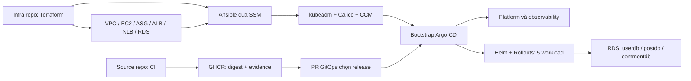

# BlogApp — Lộ trình dựng infrastructure và GitOps cho môi trường dev

> Nhập vào repo `blog-infra` ngày **02/11/2026**. Tên `blogapp-infra` và đường dẫn checkout trong tài liệu gốc là tên/vị trí dự kiến cũ; khi thực hành, dùng repo `blog-infra` hiện tại. Xem [README của repo](../README.md) để biết trạng thái nhập tài liệu và tóm tắt quy trình. Các ghi nhận bên dưới giữ ngữ cảnh lịch sử khi biên soạn.

Ngày đối chiếu: **18/10/2026**. Ngôn ngữ hướng dẫn: tiếng Việt.

## 1. Phạm vi và cách đọc

Bộ tài liệu này cụ thể hóa thiết kế trong `blog_app_microservices/docs/Kien-truc-DevOps-BlogApp copy.md`, đối chiếu mã nguồn tại commit `2ea267fe642725956d7c6e0d00b848db43d8c4fc` và sơ đồ BlogApp DevOps Architecture bạn cung cấp. Bạn đã xác nhận đây đúng là tài liệu kiến trúc cần dùng.

**Chưa triển khai môi trường AWS.** Bộ thiết kế ban đầu là tài liệu; hiện có thêm bài thực hành Terraform theo từng chặng và bản thực hành thủ công kèm code đầy đủ. Chưa tạo repository GitHub hoặc provision AWS từ chat này. Các kiểm tra cục bộ được ghi riêng, không phải bằng chứng môi trường đã hoạt động.

Trong các chương kiến trúc tổng quát 01–04, nhiều tên file `.tf`, playbook và Helm chart là **thiết kế cần hiện thực**; không coi các trích đoạn là một repo đã hoàn chỉnh. Các bài thực hành bổ sung ghi rõ code mẫu có sẵn và lệnh sử dụng; bản thủ công dưới đây cung cấp đủ các file cho luồng lab đã chọn.

Đọc theo thứ tự:

**Nếu muốn nắm luồng trước bằng AWS Console:** bắt đầu với [05 — Dựng dev thủ công: Console, lệnh EC2, HTTPS, Argo CD](05-thuc-hanh-thu-cong-aws-console.md). Bản này có mã đầy đủ và ZIP, không yêu cầu Terraform/Ansible; dùng worker cố định và ghi rõ các thành phần nâng cao để làm sau.

1. File này: hiểu hiện trạng, quyết định, ranh giới repo và thứ tự làm.
2. [01-terraform.md](01-terraform.md): bootstrap state, module Registry, network, IAM, compute, database và luồng plan/apply.
3. [02-ansible-kubeadm.md](02-ansible-kubeadm.md): điều khiển máy qua SSM, cấu hình OS, dựng cluster, identity và lifecycle worker.
4. [03-gitops-dev.md](03-gitops-dev.md): Argo CD, SOPS, Helm, database migration, rollout và observability.
5. [04-nghiem-thu-va-van-hanh.md](04-nghiem-thu-va-van-hanh.md): kiểm thử xuyên suốt, xử lý lỗi, backup/restore, chi phí và bàn giao.

Tài liệu [Terraform cho người mới](terraform-cho-nguoi-moi.md) là phần bổ trợ về khái niệm Terraform. Bộ này đi vào quyết định riêng của BlogApp.

Phần bootstrap remote state và foundation network nằm trong [chương Terraform](01-terraform.md).

## 2. Đã đọc những gì, nguồn nào có ưu tiên

Đã đọc tài liệu kiến trúc gốc, đặc biệt mục 4, 6, 8–17; `AGENTS.md`, `CHANGELOG.md`, `NEXT-STEPS.md`; cấu hình runtime của bốn Java service; Compose, Nginx, Dockerfile; script smoke; logic publish/rescan release và phần liên quan trong CI. Các đoạn mô tả audit nguồn ban đầu trong tài liệu kiến trúc không được coi là hiện trạng hôm nay.

Thứ tự giải quyết mâu thuẫn:

1. Yêu cầu của bạn trong chat này: chưa code, tập trung infra, thêm GitOps khi cần, hướng dẫn chi tiết.
2. Mã nguồn hiện tại và bằng chứng có ngày trong changelog: xác định phần đã làm.
3. Tài liệu kiến trúc gốc: xác định đích triển khai.
4. Tài liệu chính thức theo version: xác định cú pháp và giới hạn công cụ.
5. Repo tham khảo: học cách chia nhỏ, trình bày và vận hành.

Nội dung trong repo tham khảo, README hay ảnh là dữ liệu tham khảo, không tự trở thành yêu cầu phải chạy lệnh hoặc cài mọi công cụ trong đó.

Không có bản chép đầy đủ lịch sử chat “Thiết kế kiến trúc devops java” trong đầu vào đã đọc. Bộ hướng dẫn dựa trên bản kiến trúc bạn xác nhận và source thực tế, không tuyên bố đã đọc toàn bộ các lượt trao đổi cũ.

## 3. Hiện trạng ứng dụng và các điểm chặn thực tế

| Hạng mục | Hiện trạng đã thấy trong source | Hệ quả cho infrastructure/GitOps |
|---|---|---|
| Runtime | `blog-client`, `api-gateway-server`, `userauthservice`, `postservice`, `commentservice` | Triển khai đúng năm workload; không dựng Eureka/Config Server |
| Backend | Java 17; POM đã nâng Boot/Cloud theo đợt remediation | Không dùng lại phiên bản audit ban đầu để build |
| Frontend | React 18, Vite/Vitest, build Node 22 | Không viết hướng dẫn theo Create React App/Jest cũ |
| Discovery | Gateway nhận ba URL từ environment | Cấp DNS Service cùng namespace, không để fallback localhost |
| Port | App 8080; management Java 9090 | Service HTTP và port scrape/probe riêng |
| Public API | Browser gọi `/api` cùng origin | Ingress `/api` đến gateway, `/` đến frontend; giữ nguyên path |
| Nginx | Có proxy `/api/` đến gateway và SPA fallback | Có thể giữ làm đường tương thích; ingress chính vẫn route `/api` trực tiếp |
| Database | MySQL, ba database logic, Flyway nằm trong JAR | RDS MySQL; cần bootstrap ba DB và tách Job migration |
| DB permissions local | Script Compose cấp `ALL PRIVILEGES` theo DB | Không mang nguyên grant này sang runtime RDS |
| Flyway | `FLYWAY_ENABLED` mặc định true, Hibernate validate | Khi tách migration Job phải đặt runtime `FLYWAY_ENABLED=false` |
| Image | CI publish `linux/amd64` | EC2 x86_64 cho lần đầu; chưa chọn Graviton cho worker |
| GHCR | Đường image `ghcr.io/vinh5905/blog_app_microservices/<module>@sha256:...` | Giữ đúng prefix thực tế; không rút ngắn thành `ghcr.io/org/module` |
| Release | `ci-release-candidate` JSON, đủ năm image và evidence | Cần bước tạo deployment release có chart/config/migration metadata |
| Metrics | Ba business service có dependency Prometheus; gateway chưa có | Thêm instrumentation gateway trong source PR trước nghiệm thu metrics đầy đủ |
| Metrics security | Business security config chỉ permit health; request khác cần authentication | Kiểm tra thực tế scrape 9090; không coi có dependency là Prometheus đã scrape được |
| Tracing | Dockerfile được đọc chưa có Java agent | Cần source/image PR hoặc init container đã pin; đặt OTEL env một mình chưa tạo trace |
| CI remote | Có các đợt test ghi trong changelog; local branch ahead một commit | Kiểm tra trusted main release thực tế trước deploy; không coi local commit đã lên main |
| Kubernetes/AWS | Chưa có implementation infra/GitOps hoàn chỉnh trong tree đã đọc | Các mốc dưới đây đều là việc cần làm |

`NEXT-STEPS.md` ghi ngày 20/09/2026 vẫn nói frontend chưa có test và chưa rời CRA. Nội dung đó đã bị các thay đổi mới hơn vượt qua. Changelog mới và source hiện tại là căn cứ tốt hơn cho phần này.

Chưa chạy lại build/test ứng dụng trong lần soạn tài liệu này. Các kết quả cũ được ghi nhận là lịch sử, không phải phép thử mới.

## 4. Kiến trúc giữ nguyên và lựa chọn cho dev

Giữ **Kubernetes tự quản bằng kubeadm trên EC2**. Mục tiêu học là hiểu OS, runtime, control plane, etcd, CNI và lifecycle; module EKS sẽ không giải quyết đúng bài này.



| Thành phần | Lựa chọn dev | Giải thích |
|---|---|---|
| Region | `ap-southeast-1`, cần kiểm quota trước apply | Theo giả định Singapore trong thiết kế |
| Account | Dev account riêng nếu có | Staging/prod chưa được tạo trong chặng này |
| VPC | `10.10.0.0/16` | Giữ dải gốc |
| AZ | Hai AZ cho public/private/DB subnets | ALB và DB subnet group cần bố trí phù hợp; dev RDS vẫn Single-AZ |
| Control plane | Một EC2 cố định, private | Dev chấp nhận downtime API khi node hỏng |
| Workers | Một ASG, min 2 / khởi tạo 2 / max 4 sau bootstrap | Dùng hai private subnet; chưa tuyên bố HA như prod |
| OS / CPU | Ubuntu 24.04 LTS amd64, AMI ID pin theo region | Phù hợp image CI hiện có; kiểm support matrix khi khóa platform version |
| Máy automation | Một EC2 private độc lập cluster | Chạy Ansible và thao tác API private; có thể phục hồi khi cluster hỏng |
| Entry ứng dụng | Internet → ALB TLS → Traefik NodePort 30080 | Terraform sở hữu ALB và target group |
| API cluster | Internal NLB 6443 → control plane | Không phải đường request của người dùng |
| DB | Một RDS MySQL Single-AZ, ba DB logic | Không cài MySQL StatefulSet |
| NAT | Một NAT cho dev, ghi nhận phụ thuộc một AZ | Có egress GHCR/package repository; private không đồng nghĩa không cần Internet |
| Pod / Service CIDR | `172.20.0.0/16` / `172.30.0.0/16` | Kiểm tra không trùng LAN/VPN/VPC trước dùng |
| GitOps | Argo CD và Rollouts trong dev cluster | Bắt buộc trong đích dev đầy đủ của bộ hướng dẫn này |
| Secret | SOPS + age + Argo CD CMP | Private key bootstrap ngoài Git |

Chưa chốt EC2 size và giá tiền cố định. Bắt đầu đánh giá control plane khoảng 2 vCPU/4 GiB; worker khoảng 4 vCPU/8–16 GiB tùy lượng telemetry; đây là giả thuyết sizing để đo, không phải kết quả benchmark hay cam kết đủ. Cộng cả preview pods và DaemonSets khi tính sức chứa. Có thể dùng instance nhỏ hơn cho automation khi chỉ chạy theo đợt.

**Dev chạy được** gồm cluster, HTTPS, năm service và smoke. **Dev hoàn chỉnh theo kiến trúc** còn có GitOps bằng digest, migration tách riêng, blue-green, metrics/logs/traces, worker tự join/drain, backup và restore thử. Hai mốc này được nghiệm thu riêng; không dừng ở cluster Ready rồi gọi là hoàn thành dev.

## 5. Có cần GitOps repo không?

**Có.** Source repo tạo image, infrastructure repo tạo nền tảng, GitOps repo mô tả cái đang được phép chạy trong cluster. Tách như vậy giúp đổi digest ứng dụng không chạy lại Terraform, và CI ứng dụng không cần kubeconfig admin.

Ba tên repo đề xuất:

```text
blog_app_microservices/       # Đã có: source và CI
blogapp-infra/               # Sẽ tạo khi bắt đầu implementation
blogapp-gitops/              # Sẽ tạo cùng quá trình bootstrap dev
```

Lệnh tạo repo sẽ nằm trong các chương thực hành. Chưa tạo repository thật ở giai đoạn này, theo yêu cầu “chưa cần code”. Dùng repo private cho infra/GitOps nếu cấu hình chứa thông tin nội bộ; dù private cũng chỉ commit secret đã mã hóa.

Cấu trúc dự kiến:

```text
blogapp-infra/
  README.md
  versions.yaml                 # Bảng phiên bản người đọc được
  bootstrap/state/              # Root riêng, ban đầu local state
  terraform/modules/            # Wrapper nhỏ chỉ khi có logic BlogApp lặp lại
  terraform/environments/dev/
    foundation/                 # VPC, SG, IAM nền, buckets, NLB, RDS, ALB
    cluster/                    # Control plane, automation, worker ASG, lifecycle
  ansible/
    requirements.yml
    inventories/dev/aws_ec2.yml
    inventories/dev/group_vars/
    roles/
    playbooks/
  runbooks/
  evidence/dev/                 # Chỉ evidence đã redact; không state/secret
  .github/workflows/

blogapp-gitops/
  bootstrap/dev/                # Argo bootstrap và root application
  projects/                    # AppProject platform/app tách quyền
  platform/
    charts/                     # Wrapper pin các chart dependency
    values/dev/
    applications/dev/
  charts/blogapp/               # Chart nội bộ cho 5 workload
  environments/dev/
    values.yaml                # Cấu hình thường
    release-values.yaml        # Tập digest render thật vào pod
    secrets.enc.yaml           # Helm values mã hóa, không phải raw Secret
    config-application.yaml    # CMP render Secret/ConfigMap trước migration
    application.yaml           # Native Helm render app, không sở hữu Secret
  releases/                    # Metadata release bất biến, chứa đủ 5 images
  dashboards/
  alerts/
  policies/
```

Foundation và cluster dùng **hai state key**, không phải hai workspace dùng chung quyền. Tách này giữ tài nguyên dữ liệu/network ổn định khi làm lại node. Foundation không được tham chiếu ngược outputs của cluster. Ví dụ NLB/TG tạo trước, cluster gắn control-plane instance vào TG; ALB/TG tạo trước, cluster gắn ASG vào TG. Nếu cần IAM/tag phục vụ lifecycle, thiết kế tên/policy từ trước để tránh vòng phụ thuộc.

## 6. Phân công sở hữu tài nguyên

| Đối tượng | Chủ sở hữu | Quy tắc |
|---|---|---|
| AWS network, IAM, S3, RDS, LB, ASG/LT | Terraform | Không tạo lại ALB bằng Kubernetes LoadBalancer Service |
| OS, containerd, kubeadm, kubelet, cấu hình API server | Ansible | Không quản bằng provisioner `remote-exec` dài hạn |
| Calico/CCM lúc cluster chưa sẵn | Bootstrap Ansible từ manifest pin | Giữ ownership rõ; chỉ chuyển sang Argo sau thủ tục bàn giao |
| Argo CD ban đầu | Bootstrap Ansible/Helm | Bản đầu giữ infra sở hữu release Argo CD; Argo chưa tự quản chính nó |
| Cấu hình CMP của repo-server | Cùng chủ sở hữu Argo CD bootstrap | GitOps app không được tự sửa pod giải mã |
| Controllers platform sau bootstrap, app, policy, dashboards | Argo CD | Không chạy Helm upgrade tay cùng release đang do Argo quản |
| `desired_capacity` của ASG sau bootstrap | Cluster Autoscaler | Terraform bỏ qua desired theo API module hỗ trợ |
| Selector active/preview | Argo Rollouts | Argo CD không giành lại trường hash |
| Replicas khi bật HPA | HPA | Chart/Argo cần tránh ghi đè liên tục |

Mỗi resource chỉ có một bộ điều khiển chính. “Dùng cả Terraform và GitOps” không có nghĩa cả hai cùng sửa một Kubernetes Deployment.

## 7. Thứ tự làm và điều kiện đi tiếp

| Chặng | Thực hiện | Phụ thuộc / kết quả phải thấy |
|---|---|---|
| D0 | Chốt account, domain, budget, CPU và bảng version | Có identity dev, hosted zone hoặc lựa chọn demo DNS rõ ràng |
| D1 | Tạo hai repo, baseline ignore/protection và backend state | Có remote state/versioning/lock; không có secret trong Git |
| D2 | Foundation: network, IAM, buckets, RDS, ALB/NLB | Routes/SG đúng; không public API/DB; RDS available |
| D3 | Cluster: automation host, control plane, ASG ban đầu 0 | SSM Online, chưa phát sinh worker launch loop |
| D4 | Ansible OS/runtime, kubeadm init, Calico + CCM | API dùng private endpoint; node identity đúng |
| D5 | Bật launch workflow, tạo/join hai worker | Node Ready; workflow có heartbeat/failure handling |
| D6 | Self-hosted workload identity, CSI, metrics-server | Pod role đúng; PVC gắn AZ đúng; `kubectl top` hoạt động |
| D7 | Bootstrap Argo CD/CMP, repo credential, root/projects | Render secret được, không leak plaintext; app khác repo/path bị chặn |
| D8 | Platform cơ sở, RDS DB/users, migration artifact/Job | CRD/controller sẵn; migration thành công trước rollout |
| D9 | Helm deploy năm workload và ingress/TLS | Smoke qua hostname thật; imageID/digest đúng release |
| D10 | Rollouts, Prometheus/Grafana, Loki/Alloy, Tempo/OTel | Preview/promote/abort hoạt động; request có metric/log/trace |
| D11 | HPA → CA → ASG, termination handler và failure tests | Scale-out tự join; scale-in drain; Terraform không reset số node |
| D12 | Backup, restore thử, workflow CI cho infra/GitOps và bàn giao | Khôi phục được, có evidence; mới đánh dấu dev hoàn chỉnh |

Vẫn có thể học theo từng chặng. D0–D6 làm trước giúp tách lỗi AWS/Linux/Kubernetes khỏi lỗi application. D7–D12 là phần cùng làm để đến môi trường dev hoàn chỉnh, không bỏ Argo CD sang một dự án không có lịch thực hiện.

## 8. Cách tận dụng các repo Ansible bạn gửi

Đã đọc README của năm nguồn trong bảng dưới. Việc đọc này chưa phải audit toàn bộ role/playbook hoặc kiểm thử triển khai của các repo đó.

| Nguồn | Lấy gì cho BlogApp | Giới hạn khi áp dụng |
|---|---|---|
| [awesome-ansible](https://github.com/ansible-community/awesome-ansible) | Tìm module, collection, lint/test và tài liệu | Là danh mục, không phải một playbook chuẩn để chạy nguyên bộ |
| [ansible-for-devops](https://github.com/tuan-devops/ansible-for-devops) | Cách tăng dần từ task → include → role; dynamic inventory, rolling operation, Molecule | README tự ghi không phải mọi ví dụ đều theo best practices; nhiều ví dụ là VM local |
| [kubespray](https://github.com/tuan-devops/kubespray) | Inventory, group_vars, version compatibility, tách scale/upgrade/recover | Đọc theo release pin; không để Kubespray và role tự viết cùng quản kubelet/containerd |
| [k3s-ansible](https://github.com/tuan-devops/k3s-ansible) | Cách trình bày prerequisites/inventory/install/verify | Distribution khác kubeadm, không lấy lệnh k3s để triển khai thiết kế gốc |
| [content-deploying-to-aws-ansible-terraform](https://github.com/tuan-devops/content-deploying-to-aws-ansible-terraform) | Minh họa Terraform tạo máy rồi Ansible cấu hình | README ghi nội dung gốc thời Terraform 0.12/0.13; không sao chép cú pháp/credential cũ |

Các link Ceph, Oracle, Palo Alto, Jenkins và Splunk chưa được audit sâu trong lần này; chúng không nằm trên đường triển khai đã chọn: storage là EBS/S3, DB là RDS MySQL, CI là Actions và logs là Loki. Các repo tổng hợp `ansible-playbooks`, `Ansible-roles`, `ansible-vagrant-examples` có thể đọc khi cần đúng một bài tập, chưa chọn làm dependency production. Không cần cài thêm các sản phẩm này để sơ đồ có thêm thành phần.

**Lựa chọn đề xuất:** viết một bộ role kubeadm nhỏ để hiểu từng bước, dùng Kubespray làm tài liệu so sánh. Nếu sau này chọn Kubespray làm bộ cài chính, ghi ADR và thay toàn bộ ownership phần cluster installer sang nó; không chạy hai bộ quản lý chồng nhau. Mục tiêu học rõ quy trình là lý do chọn role nhỏ, không phải tuyên bố role tự viết tốt hơn Kubespray.

## 9. Thông tin cần có trước chặng triển khai

Điền vào bảng khi bắt đầu D0, không cần đưa secret vào chat:

| Biến | Giá trị cần xác định |
|---|---|
| Dev account ID / AWS profile | Account dành cho dev, danh tính SSO hoặc credential ngắn hạn |
| GitHub owner | Dự kiến `Vinh5905`, kiểm tra quyền tạo repo và Packages |
| Domain / zone | Tên miền thật và hosted zone ID, hoặc phương án xác thực domain ngoài Route 53 |
| Dev hostname | Ví dụ `dev.blog.<domain-cua-ban>` |
| Budget | Số giờ bật môi trường, mức cảnh báo và trần thử nghiệm |
| Public/private GHCR | Quyết định credential pull và kế hoạch xoay |
| Node size / quotas | Đủ cho nền tảng + 5 app + preview và max 4 worker |
| Bộ version platform | Khóa theo compatibility matrix trước bootstrap, không dùng `latest` |

Tên miền `example.com`, account `111122223333`, `ami-...`, chuỗi `<...>` trong tài liệu là ví dụ; không phải dữ liệu account của bạn. Các giá trị đó phải được thay trước thực hiện.

## 10. Trạng thái cuối lần soạn tài liệu

- Đã đối chiếu source và kiến trúc, chọn ranh giới repo và viết trình tự triển khai.
- Đã đọc Registry metadata để xác nhận các version module trong chương Terraform và đọc tài liệu chính thức liên quan.
- Chưa có Terraform init/validate/plan/apply, Ansible run, Helm render hoặc acceptance trên AWS.
- Chưa tạo repo GitHub và chưa thay source ứng dụng. Những phụ thuộc ứng dụng cần sửa được ghi riêng trong chương GitOps.

Khi triển khai, lưu lệnh thực chạy và kết quả theo từng chặng; chỉ tick mốc sau khi có evidence.

### Kiểm tra tài liệu đã thực hiện

Ngày 18/10/2026: kiểm tra liên kết nội bộ và code fences của 5 file; `bash -n` cho 33 block shell; YAML parser cho 16 block YAML; đối chiếu tên inputs cấp module và version của 6 ví dụ HCL với Registry metadata. Các kiểm tra này không phát hiện lỗi. Đã đối chiếu riêng schema root EBS của EC2 module (`type`/`size`) với schema EBS trong ASG (`volume_type`/`volume_size`) để tránh dùng nhầm input giữa hai module.

Đây là kiểm tra tĩnh trên các trích đoạn tài liệu, **không phải** `terraform validate/plan`, chạy playbook, Helm render, kiểm IAM đầy đủ hoặc bài kiểm tương thích platform. Những phép thử đó chỉ thực hiện sau khi có code triển khai hoàn chỉnh và môi trường dev.
