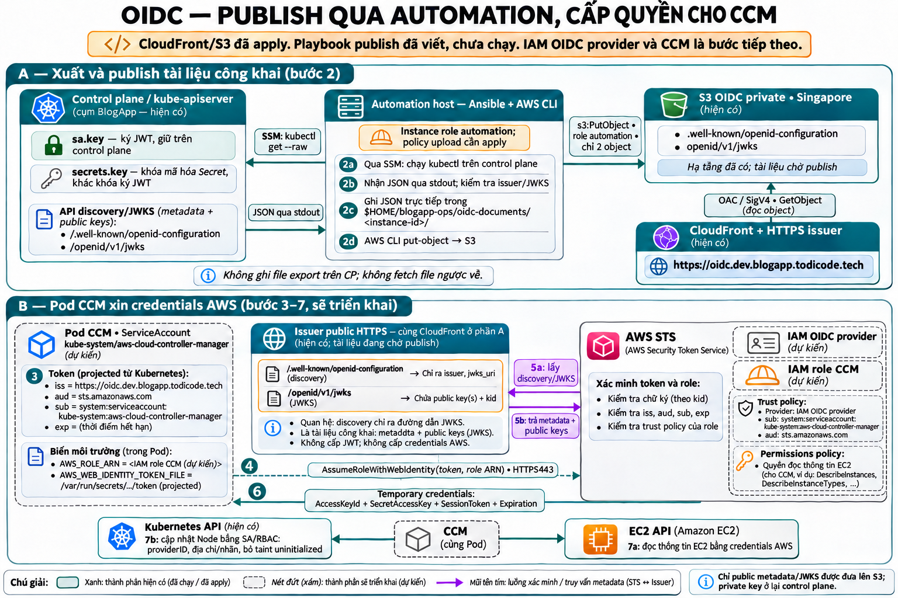

# Publish tài liệu OIDC công khai

Playbook: `ansible/playbooks/25-oidc-documents.yml`.

## Luồng xử lý

1. Ansible trên automation host dùng SSM để chạy `kubectl get --raw` trên control plane.
2. Kube-apiserver trả discovery và JWKS qua stdout. Ansible kiểm tra issuer, JWKS URL và public key.
3. Ansible tạo hai file JSON trực tiếp trên automation bằng `delegate_to: localhost`, `become: false`.
4. AWS CLI trên automation dùng instance role automation để upload đúng hai object lên S3.
5. CloudFront đọc object từ S3 qua OAC và phục vụ issuer HTTPS cho AWS STS.
6. Ansible trên automation kiểm tra cả hai URL public trả HTTP 200 và JSON khớp dữ liệu vừa đọc từ cluster; thử lại khi CloudFront còn giữ cache cũ.

Playbook không ghi file export trên control plane và không dùng `fetch`. API Kubernetes trên control plane vẫn private; chỉ hai tài liệu metadata/public key được publish. Private signing key không được xuất.

File trên automation nằm ngoài repo:

```text
$HOME/blogapp-ops/oidc-documents/<control-plane-instance-id>/
├── .well-known/openid-configuration
└── openid/v1/jwks
```

## Điều kiện trước khi chạy

- Automation và control plane đã chạy, SSM online, control plane đã `kubeadm init`.
- Automation có repo mới nhất, Python venv, dependencies Ansible, AWS CLI và Session Manager plugin theo runbook automation.
- Bucket OIDC/CloudFront đã apply và hostname issuer đã trỏ tới CloudFront.
- Inline policy `blogapp-dev-oidc-publish` đã được apply vào role `blogapp-dev-automation`. Policy chỉ cấp `s3:PutObject` cho hai key bên dưới.

```text
Bucket: blogapp-dev-oidc-947856326077-ap-southeast-1
Keys:
  .well-known/openid-configuration
  openid/v1/jwks
```

Nếu mới có plan policy, chạy `terraform apply foundation-oidc-publish.tfplan` trong root `terraform/environments/dev/foundation` trước khi publish.

## Chạy trên automation host

Các lệnh sau chạy từ repo đã clone trên automation, sau khi thay đổi code đã được push:

```bash
cd "$HOME/blogapp-ops/blog-infra"
git pull --ff-only
. "$HOME/blogapp-ops/.venv/bin/activate"

ansible-playbook \
  -i ansible/inventories/dev/aws_ec2.yml \
  ansible/playbooks/25-oidc-documents.yml \
  --syntax-check

ansible-playbook \
  -i ansible/inventories/dev/aws_ec2.yml \
  ansible/playbooks/25-oidc-documents.yml
```

`localhost` trong playbook là automation host vì đây là nơi chạy Ansible. Các task tạo thư mục, render và upload chạy tại đó bằng user chạy Ansible. Task đọc Kubernetes API chạy trên control plane.

`--check` vẫn đọc API và kiểm tra dữ liệu, nhưng chỉ dự đoán thay đổi file và bỏ qua upload cùng bước xác minh URL public sau upload. Khi chạy bình thường, mỗi lần publish thực hiện hai `PutObject`; bucket bật versioning nên mỗi lần upload tạo phiên bản object mới. Không dựa vào trạng thái file cục bộ để bỏ qua upload, tránh bỏ sót lần publish trước bị lỗi.

## Kiểm tra sau publish

```bash
curl --fail --show-error --silent \
  https://oidc.dev.blogapp.todicode.tech/.well-known/openid-configuration

curl --fail --show-error --silent \
  https://oidc.dev.blogapp.todicode.tech/openid/v1/jwks
```

Kết quả cần là JSON; issuer và jwks_uri phải đúng hostname public, JWKS chứa public key. Object được upload với `Content-Type: application/json`, `Cache-Control: public,max-age=300`; CloudFront có thể còn giữ bản cache cũ trong lúc cập nhật.

Trong trình tự bootstrap mới, publish tài liệu phải xong trước IAM OIDC provider và CCM. Với môi trường đã thực hành trong chat, provider, role CCM và role Node Termination Handler đã được tạo, CCM/NTH đã chạy. Xem [tiến độ dev](../tien-do-dev.md) để chọn bước tiếp tục.

## Hình minh họa


